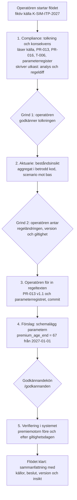

# Beslutsförslag: flödesmotorn (Fas 3c) och en minimal flaggskeppsdemo

> **Status:** Godkänt av operatören i chatten 2026-10-25, med valen A–L enligt rekommendationerna i §9, och loggat som **B-035**. Byggs i stegen i §11, med början i 3c-P1.
> **Datum:** 2026-10-25, på `main` `fe4be6a` (Fas 5 F5-1–F5-4 klar, F5-5 halvklar, Digital klarhet i handläggar-UI:t).
> **Underlag:** MASTER_CONTEXT §1 (flaggskeppsscenariot); `02_system/agentekosystem.md` §5.4, §6.2 och §12; `02_system/harness.md` §4.2–4.3, §5.1–5.2, §9.2–9.3 och §10; `02_system/Agentsystem/regelförändringsflöde.md`; `04_regulatoriskt/03_bevakning/kallandringar.md`; PR-ITP1-001, -013, -016 och -032; `01_domän/parametrar/PARAMETERREGISTER.md`; `src/skills/calculation/calculate_itp1_premium.py`; `src/analytics/premium_impact.py`.
> **Bygger på:** B-016, B-017, B-024, B-026, B-028, B-031, B-033.

> **Läsanvisning efter operatörens förtydligande 2026-10-25:** detta är B-035:s
> historiska beslutsunderlag och ett avgränsat test-/visningsscenario. Bolagets
> mål är ett hypotetiskt fungerande AI-native tjänstepensionsföretag enligt
> [MASTER_CONTEXT §1](../MASTER_CONTEXT.md#1-vision-och-syfte). Verksamhetsbehov
> styr fortsatt bygge. Regeländringshantering ska stödja olika ändringar och
> följdåtgärder; scenariot 66 → 67 och dess skriptade modell är teststöd.
> Ingen hårdkodad demo-knapp eller särskild demoberättelse ska införas i bolagets
> ordinarie arbetsytor. Röktest av byggda funktioner skiljs från ett senare
> visningsmanus. Valen och den ursprungliga byggordningen nedan bevaras som
> beslutshistorik; de ger inte demonstrationen företräde framför verksamhetsbehov.
> [Beslutsförslag för formalisering](bolagsvision_beslutsforslag.md).

---

## 1. Varför

Flaggskeppet ska visa ett spårbart flöde: en regelverksändring tolkas av agenter till produktregler, ändringen
sätts i produktion i försäkringssystemet, och agenterna tar fram en beståndsinsikt. Människan beslutar i de
kritiska stegen (MASTER_CONTEXT §1, §3.5).

Vid förslagets tillkomst fanns en agent i ett team (`forsakring`) och inget sätt att köra flera team i följd. Tre luckor identifierades:

1. **Ingen flödesmotor.** Flödet behöver ett sparat tillstånd, eftersom en människas beslut kan dröja i flera
   dagar, och det behöver grindar som binds till exakt det underlag som godkänts (`harness.md` §10.3).
2. **Reglerna är text, men motorn är kod.** Premieåldern står som konstanter i premiemotorn
   (`AGE_PREMIUM_START = 25`, `AGE_PREMIUM_END = 66`). En antagen regeländring kan därför bara nå produktion genom
   en kodändring. Det är just den svåraste delen av flaggskeppet: steg 3 med utvecklingsteamet, en patch i
   isolerad miljö och en release (`harness.md` §9.7).
3. **Inga team för tolkning och insikt.** Compliance och aktuarie saknar profiler. Poddarna `regelverk`,
   `dokument` och `bestand` saknar gateways.

Det här förslaget krymper vägen till en första demo. **Parametrar som styr beräkningar görs till versionerad
data med giltighetsdatum.** En regeländring som bara ändrar ett värde kan då sättas i produktion genom en
granskad tjänsteoperation, utan kodändring och utan utvecklingsteam. Ändringar som kräver ny logik går
fortfarande via utveckling, men det är en senare runda.

## 2. Demon i korthet

**Scenario (val A):** en *fiktiv* ändring i kollektivavtalet gör att den ordinarie ITP1-premien betalas till och
med månaden före **67 år** i stället för 66, för premiemånader från och med **2027-01-01**. Källan är en märkt
simuleringskälla i källregistret (B-003). Den ger sig inte ut för att vara verklig.

Människan beslutar fyra gånger: tolkningen, regelbeslutet, regeltexten i repot och aktiveringen. Agenterna gör
tolkning, konsekvensanalys och insikt. Systemet gör verifieringen. Kundinformation (steg 5 i
`agentekosystem.md` §6.2) och utvecklingsteamet ingår inte i demon (§10).

## 3. Det som finns och det som saknas

| Del | Finns | Byggs här |
|---|---|---|
| Harness | Loop, dispatcher, resursmandat, körjournal, fortsättning efter godkännande, tak (3b-1–3b-8) | Resultatscheman per steg, resurskontroll för parameterförslag |
| Godkännande | Tjänstelagrets kö, UI:t `/godkannanden` | Länk från flödet till förslaget |
| Regelunderlag | Källregister, tio tolkningar, PR-ITP1 v1.0, parameterregister | Fiktiv källa, läsgateway (`regelverk`) |
| Utkast | – | Dokumentgateway som bara skriver utkast (`dokument`, `harness.md` §5.2) |
| Beräkning | Premiemotorn, IBB-analysen i `src/analytics/` | Parametrar som data, aggregattjänst (`bestand`) |
| Team | `forsakring` | `compliance` och `aktuarie` |
| Flöde | – | Flödesmotorn med tabeller, grindar och UI |

## 4. Produktparametrar som data

**Tabellen `product_parameters`.** Varje rad är en version av en parameter med giltighetsintervall,
enligt parameterregistrets avsnitt *Parameterändring* (värde, enhet, giltighet, källa, beslut).

| Kolumn | Typ | Krav och syfte |
|---|---|---|
| `id` | `UUID` | Primärnyckel |
| `key` | `VARCHAR(60)` | `CHECK` mot kända nycklar. v1: `premium_age_start`, `premium_age_end`, `premium_rate_low`, `premium_rate_high`, `premium_breakpoint_low_ibb`, `premium_breakpoint_high_ibb` – i dag konstanter i premiemotorn |
| `value` | `NUMERIC(12,6)` | Värdet i parameterns enhet |
| `unit` | `VARCHAR(20)` | `years`, `rate` eller `ibb` |
| `valid_from` | `DATE` | Första premiemånad som omfattas, alltid en månadsförsta |
| `valid_to` | `DATE` | Sista dag, eller null för tills vidare. Sätts när en senare version schemaläggs |
| `rule_id`, `rule_version` | `VARCHAR` | Produktregeln som bär värdet, t.ex. `PR-ITP1-013` `1.1` |
| `source_ref` | `VARCHAR(60)` | Källan i källregistret |
| `decision_ref` | `VARCHAR(60)` | Beslutet: flödets grindbeslut, B-nummer eller seed |
| `status` | `VARCHAR(20)` | `valid` eller `withdrawn`. Om en version är kommande, gällande eller upphörd härleds av datumen (ändrat vid bygget, 3c-P1: ett lagrat tillstånd skulle bli inaktuellt när datumet passeras) |
| `created_by`, `created_at` | | Som övriga tabeller |

Unikt på `(key, valid_from)`. Intervallen får inte överlappa; tjänstelagret kontrollerar det i samma
transaktion och låser parameterns rader.

**Seed med dagens värden från 2023-01-01** (25 år, 66 år, 4,5 %, 30 %, 7,5 och 30 IBB). Ett test räknar om alla
befintliga premier med de lästa parametrarna och kräver identiskt resultat. Inga gamla belopp ändras
(PR-ITP1-032).

**Premiemotorn får parametrarna som indata.** `calculate_itp1_premium` tar emot ett objekt
`PremiumParameters`; dagens konstanter blir standardvärdet, så den rena funktionen och dess 17 tester förblir
oförändrade. Tjänstelagret slår upp de parametrar som gäller för premiemånaden och skickar med dem. Varje
beräkning sparar parametrarnas versioner i `calculation_basis`, som redan finns för spårbarhet.

**Operationer:**

| Operation | Typ | PII | Register | Vad den gör |
|---|---|---|---|---|
| `get_product_parameters` | `read` | Nej | `AGENT` | Gällande och schemalagda versioner för ett datum eller intervall |
| `schedule_product_parameter_change` | `write` | Nej | `APPROVAL` | Ny version från en framtida månadsförsta. Ingen retroaktivitet, ingen överlappning, och tidigaste giltighet är nästa månad. Kräver rule- och källreferens. Regler: PR-ITP1-032 och regeln som bär värdet |
| `withdraw_product_parameter_change` | `write` | Nej | `HUMAN_ONLY` | Drar tillbaka en version som ännu inte börjat gälla |

Före 2026-11-01 är skrivningarna `HUMAN_ONLY` genom regelgolvet, precis som för löneunderlag (B-028, B-031).

**Ärligt om "i produktion".** Premiemotorn används i dag av förhandsberäkningen, analyserna och
premiehistoriken. Fakturering av premie ur löneunderlag finns inte ännu (ATT_GORA, Fas 1f). Aktiveringen
betyder alltså att försäkringssystemets beräkningar följer den nya regeln från giltighetsdagen. Den betyder
inte att fakturor skickas.

## 5. Team, poddar och gateways

| Team | Agent | Modellroll | Poddar i demon | Får inte |
|---|---|---|---|---|
| `compliance` | `compliance_agent` | `deep` | `regelverk`, `dokument`, `berakning` | Kunddata, ändra gällande regeltext, skriva B-nummer |
| `aktuarie` | `actuary_agent` | `deep` | `bestand`, `berakning`, `regelverk`, `dokument` | Individdata, anta ny tariff, ändra parametrar |

**`regelverk` – läsgateway.** Versionsbundna handtag till källregistret, tolkningarna, produktreglerna,
parameterregistret och den fiktiva källan, med utdrag om högst 8 KiB (`harness.md` §5.2). Inget generellt
filverktyg. Innehållet är underlag, aldrig instruktion. Verktyg: `list_regulatory_documents`,
`read_regulatory_document`.

**`dokument` – utkastgateway.** Skriver Markdown i `logs/agent_artifacts/<team>/<run_id>/`, högst 100 KiB per
utkast, 10 utkast och 512 KiB per körning. Den kan inte röra `01_domän/`, `04_regulatoriskt/`, `src/` eller
beslutsloggen. En regeländring lämnas som utkast med diff, och operatören för in den (steg 3). Verktyg:
`write_draft`.

**`bestand` – aggregattjänst.** `estimate_parameter_change_impact(key, value, valid_from, horizon_years)`
räknar i betrodd kod med premiemotorn: berörda aktiva försäkrade, extra premiemånader och extra premievolym per
år, med baslinje och scenario åtskilda. Celler med färre än 10 individer döljs (`harness.md` §5.1). Volymen
anges i dagens lönenivå utan lönetillväxt och utan avkastning, och det står i svaret. Ej beräknat visas som ej
beräknat. Bygger på mönstret i `src/analytics/premium_impact.py`.

*Byggd i 3c-B (2026-10-25):* operationen i `src/services/operations/portfolio_impact.py` och den rena
beräkningen i `src/analytics/parameter_impact.py`, med stöd och spärrar i `tjänstelager.md` §9.5. Baslinjen följer
`product_parameters` månad för månad. Utöver undertryckningen döljs vid behov fler år, så att en dold cell inte
kan räknas fram ur totalen, och belopp avrundas till hela tusental kronor. Monterad i `bestand` sedan 3c-T.

**Resurskontroll för flödet.** Aktuarieagenten får bara räkna på den parameterändring som grind 1 godkänt.
Dispatchern jämför verktygets `key`, `value` och `valid_from` med flödets godkända förslag, på samma sätt som
`case_number` prövas mot ärendet i Fas 5. Även `horizon_years` binds, eftersom två svar med olika horisont
annars ger ett dolt års volym som differens.

*Byggt i 3c-T (2026-10-25):* teamen och agenterna i `src/agents/ecosystem.yaml`, instruktionerna i
`02_system/agenter/`, parametermandatet `ParameterChangeMandate` (dispatchern prövar varje anrop; utan mandat är
verktyget dolt), resultatschemana `InterpretationProposal` och `PortfolioImpactResult` i `src/agents/results.py`
(lästa källor, skrivna utkast och beräkningen prövas mot körningen) och uppdragsmallarna i
`src/agents/assignments.py`. Mandatet byggs ur den godkända tolkningen med `mandate_from_interpretation`.

**Databasroll.** Aggregattjänsten läser individrader internt. Den behöver en egen roll, `agent_aktuarie`, med
`SELECT` på de tabeller beräkningen kräver och rätt att skriva loggrader, men ingen rätt till affärs-DML. Modellen
ser bara aggregat. Operatören skapar rollen i Databricks (val I).

## 6. Flödesmotorn

**Tabeller** enligt `harness.md` §10.3:

| Tabell | Innehåll |
|---|---|
| `flows` | `flow_id` `FLOW-NNNNNN`, `flow_type`, definitionens version, status, indata (JSONB), aktuellt steg, `version` för optimistisk låsning, skapad av och tider |
| `flow_steps` | Ett steg per rad: nyckel, ordning, slag (`agent`, `gate`, `manual`, `system`), team och agent, status, `run_id`, resultat (JSONB, validerat mot stegets schema), `result_hash`, `approval_id`, utkastreferenser, tider och fel |
| `flow_gate_decisions` | Append-only: grind, beslut (godkänt eller avslaget), beslutsfattare, anteckning, **bunden hash** av de resultat beslutet gäller, tid |

**Statusar.** Flöde: `running`, `waiting_gate`, `waiting_manual`, `waiting_approval`, `completed`, `rejected`,
`cancelled`, `failed`. Steg: `pending`, `running`, `completed`, `waiting`, `rejected`, `failed`, `skipped`.

**Regler i motorn:**

- Flödesdefinitionen är Python-kod med ordning, scheman och villkor. Modellen bestämmer aldrig nästa steg.
- Ett steg tas med en villkorlig `UPDATE` på flödets version, så att två klick inte kör samma steg två gånger.
- En grind binder hashen av resultaten den gäller. Ändras ett resultat blir grinden inaktuell.
- Ett avslag i en grind stoppar flödet som `rejected`. Ett nytt försök är ett nytt flöde.
- Agentsteg körs med harness som vanligt, med `flow_id` och `flow_step_id` i `RunRequest`. Körjournalen
  stannar i `logs/agent_runs/` (val J).
- Ingen automatisk återupptagning efter krasch. Ett steg som var `running` vid omstart blir
  `reconciliation_required` och avgörs av operatören (`harness.md` §6.4, §10.4).
- **Grinden ersätter aldrig godkännandet av en `APPROVAL`-operation** (`harness.md` §4.2). Flödet visar båda,
  men kön ägs fortfarande av tjänstelagret.

*Byggt i 3c-2 (2026-10-25):* `src/agents/flows/` (`definition.py`, `store.py`, `engine.py`) och `src/models/flow.py`,
tabellerna i `databasschema.md` §9i, migrationen `scripts/migrations/migrate_flows.py` (inte körd mot Lakebase).
Agentsteg körs med `run_assignment` (3c-T); ett systemsteg som lägger ett förslag i kön väntar på det
(`waiting_approval`). Flödesdefinitionen `rule_change_parameter` och UI:t byggdes i 3c-3 (se nedan och §7).

**Var koden ligger.** `src/agents/flows/` med motor, lagring och definitioner. Flödestabellerna hör till harness,
inte till försäkringstjänstelagret (`harness.md` §4.3). Operatörens grindbeslut och manuella steg skrivs av
motorn med operatören som aktör.

**UI:t `/floden`.** Lista och detalj: stegen med status, resultat och kostnad, knappen *Kör nästa steg* för
agentsteg, *Godkänn* och *Avslå* med anteckning för grindar, *Markera klart* med commit-referens för det
manuella steget, och länkar till utkast, körjournal och förslaget i `/godkannanden`.

*Byggt i 3c-3 (2026-10-25):* sidorna i `src/web/routes/flows.py` (`handläggar-ui.md` §4). Handläggar-UI:t är
ett tillfälligt hem. Flöden är bolagsbeslut och flyttar till operatörscentralen i OC-7
(`operatörscentral.md` §2). Webben går genom
adaptern `src/agents/flows/console.py` (`FlowConsole`) och rör varken modeller, sessioner eller operationsmoduler.
Formulären bär flödets version och, för grindar, hashen av underlaget som visades. *Kör nästa steg* körs synkront
och en åt gången i processen (val F). När UI:t startar markeras steg som stod som pågående som
`reconciliation_required` (`mark_interrupted`), och sidan har avstämning och avbrott. Utkasten och körjournalen
visas på egna sidor, bara för stegets egna referenser. Flödena finns i demo och `svc_test`. I Lakebase visas
varför de saknas, eftersom `migrate_flows.py` inte är körd där. Agentstegen körs med en **skriptad demomodell**
(`src/agents/flows/demo_model.py`, FakeProvider) för den fiktiva källan, genom samma harness som en riktig
modell. Riktiga modellanrop hör till 3c-V. Två ändringar i motorn: en grind kan bära uppgifter
(`decision_model`) och pröva godkännandet mot tidigare resultat (`check`). Kön läses också innan flödets
transaktion öppnas, eftersom läsningen annars väntade på flödets eget skrivlås i demodatabasens SQLite-fil.

## 7. Flödet steg för steg

| Steg | Slag | Utförs av | Resultat (schema) | Människans del |
|---|---|---|---|---|
| 1 Tolkning | agent | `compliance_agent` | `InterpretationProposal`: sammanfattning, berörda regler, föreslagna parametrar (`key`, nuvarande, nytt, `valid_from`), kundpåverkan, osäkerheter, källreferenser, utkast (konsekvensanalys, diff för PR-013 och parameterregistret) | – |
| G1 | grind | operatören | Beslut bundet till steg 1 | Godkänner tolkningen |
| 2 Insikt | agent | `actuary_agent` | `PortfolioImpactResult`: berörda, extra premievolym per år, första berörda år, antaganden, dolda celler, rapportutkast | – |
| G2 | grind | operatören | Beslut bundet till steg 1 och 2: version, giltighet, valfritt B-nummer | Antar regeländringen |
| 3 Regeltext | manuell | operatören | Commit-referens | För in PR-013 v1.1 och parameterregistret, utifrån utkasten |
| 4 Aktivering | system → kö | motorn lägger förslaget | `approval_id` | Godkänner i `/godkannanden` |
| 5 Verifiering | system | motorn | `ReleaseEvidence`: parametrarnas versioner, förhandsberäkning före och efter giltighetsdagen för en syntetisk profil | – |

Compliance-agenten bör även se konsekvensen för **PR-ITP1-016**, eftersom den frivilliga 66–67-grenen blir
överflödig eller måste ändras om den ordinarie premien går till 67. Det är ett bra prov på att tolkningen inte
bara kopierar källan.

*Byggt i 3c-3 (2026-10-25):* definitionen `rule_change_parameter` i `src/agents/flows/definitions/` med stegen
`tolkning`, `g1`, `insikt`, `g2`, `regeltext`, `aktivering` och `verifiering`. Preciseringar vid bygget:

- **G1** godkänns bara om tolkningen föreslår exakt en parameterändring. Fler ändringar körs som fler flöden.
- **G2** bär regelns nya version, giltighetsdagen och ett valfritt B-nummer (`RuleAdoption`). Giltighetsdagen
  måste vara tolkningens, eftersom insikten är räknad för den dagen. En annan giltighet kräver ett nytt flöde.
- **Aktiveringen** lägger `schedule_product_parameter_change` i kön under `compliance_agent`, med tolkningens
  `run_id` och commit-referensen i motiveringen (val C). Beslutsreferensen är `FLOW-NNNNNN G2`, med B-numret
  efter när det finns. Före 2026-11-01 stoppar regelgolvet förslaget, och steget kräver då avstämning. I demo och
  `svc_test` prövas regelpaketet som om det gällde, som för demoförslagen.
- **Verifieringen** (`ReleaseEvidence`) läser parameterns gällande version dagen före och på giltighetsdagen. Den
  förhandsberäknar också en syntetisk profil månaden före och giltighetsmånaden. Profilen fyller den lägre åldern
  ett halvår före giltighetsdagen; för 66 → 67 ger det 0 kr före och premie efter. Bevisen binder versionen i
  beräkningens underlag, och avvikelser listas som problem. Saknas IBB för giltighetsåret räknar
  förhandsberäkningen med det senast fastställda och säger det (`latest_base_amount`). Demobeståndet har inte
  IBB 2027.

## 8. Ett problem i beståndet

Den äldsta aktiva försäkrade i demobeståndet är född **1979**. En premieålder på 67 berör alltså ingen förrän
2045. Insikten blir då *"ingen berörs på tjugo år; på lång sikt får alla 471 aktiva tolv extra premiemånader"*.
Det är korrekt men tunt som demo. Tre sätt att hantera det står i val A och K.

*Hanterat i 3c-B (val K):* demobeståndet (`src/utils/demo_data.py`) har en äldre kohort med 31 aktiva födda
1959–1962, och då berör 66 → 67 försäkrade redan 2027–2029. Generatorn för det delade beståndet tar fram samma
kohort som CSV (`scripts/demo/generate_mock_data.py --older-cohort-only`). I Lakebase läggs den in först efter
backup och operatörens OK (AGENTS.md §4.5); fram till dess gäller beskrivningen ovan där.

## 9. Val att stämma av

| | Fråga | Rekommendation | Alternativ |
|---|---|---|---|
| A | Scenario | **Premieålder 66 → 67 från 2027-01-01** (fiktiv). Visar hela kedjan källa → tolkning → regel → parameter → produktion, och följdfrågan om PR-016 | Fiktiv höjning av premiesatsen under brytpunkten, 4,5 → 5 %: berör alla aktiva direkt men är avtal snarare än nationellt regelverk · IBB 2027 (förslaget i `kallandringar.md`): minst bygge eftersom IBB redan är data, men ingen produktregel ändras |
| B | Hur regeln når produktion | **Parametrar som versionerad data i `product_parameters`**, ändrade via tjänstelagret | Versionerad parameterfil i repot, granskad via git · behåll konstanterna och låt utvecklingsteamet ändra koden (fullt flaggskepp, mycket större) |
| C | Vem lägger aktiveringsförslaget | **Motorn, under compliance-agentens identitet och länkat till steg 1:s körning**, som `APPROVAL` i kön | Operatören utför operationen direkt från flödessidan (en klickning färre men visar inte agentförslaget) · compliance-agenten anropar verktyget själv i steg 1 (kräver verktyget i en tolkningskörning, före grinden) |
| D | Ordning | **Insikt före beslut**: tolkning → insikt → beslut → aktivering → verifiering | Ordningen i `harness.md` §10.3, insikt efter release, där insikten bekräftar i stället för att underbygga beslutet |
| E | Flödets tillstånd | **Egna tabeller `flows`, `flow_steps`, `flow_gate_decisions` i harness**, utanför tjänstelagret | Flödesoperationer i tjänstelagret (en logg, men blandar verksamhetsområden, mot `harness.md` §4.3) · JSON-filer per flöde (inget i Lakebase, men inga radlås) |
| F | Körning av agentsteg | **Synkront när operatören klickar *Kör nästa steg***, som *Starta agent* i Fas 5 | Bakgrundsarbetare med HTMX-polling (bättre för långa `deep`-körningar, kräver arbetarprocess) |
| G | Delegering 3c-1 | **Efter demon.** Flödesmotorn kör teamen i följd, och ingen agent delegerar | Bygg delegering först, enligt byggordningen i `agentekosystem.md` §12 |
| H | Regeltexten | **Compliance skriver utkast; operatören för in texten (steg 3)** | Dokumentpodden får skriva i `01_domän/` efter grind (strider mot `harness.md` §5.2) |
| I | Databasroll för aggregaten | **Först demo och `svc_test` med simulerad roll; operatören skapar `agent_aktuarie` före skarp demo i Lakebase** | Återanvänd `agent_forsakring` (har PII-scope för fel ändamål) · kör aggregaten med `app_backend` (ingen databasgräns) |
| J | Körjournalen | **JSONL som i dag; `flow_steps.run_id` länkar** | Tabellerna `agent_runs` och `agent_steps` nu (öppen fråga i `agentekosystem.md` §13) |
| K | Beståndet för scenario A | **Utöka demobeståndet med en fiktiv äldre kohort**, ungefär 30 försäkrade födda 1959–1962, genom generatorn och anslutningsoperationen. Först i demo och `svc_test`, i Lakebase efter backup och OK | Behåll beståndet och redovisa långsiktig effekt · byt till scenariot med premiesatsen (val A) |
| L | Fiktiv källa | **`K-SIM-ITP-2027` i källregistret och ett källdokument i `04_regulatoriskt/03_bevakning/`, tydligt märkta som fiktiva** | Operatören skriver in ändringen som fri text när flödet startas (svagare spårbarhet) |

## 10. Utanför demon (förslag till ATT_GORA)

- Utvecklingsteamet: patch i isolerad arbetsyta, tester och release för ändringar som kräver ny logik (`harness.md` §9.7).
- Kommunikationsteamet: kundinformation om ändringen, med godkännande av exakt utskick (§3.5).
- Delegering mellan team (3c-1) och flera flödestyper.
- Bakgrundsarbetare och automatisk återupptagning med idempotens (`harness.md` §10.4).
- Körjournalen i Lakebase, och fakturering av premie ur löneunderlag så att aktiveringen märks i fakturor.

## 11. Byggsteg efter beslut

| Steg | Innehåll |
|---|---|
| 3c-P1 | `product_parameters` i `databasschema.md` och `src/models/`, migration med seed, `PremiumParameters` i premiemotorn, uppslag i tjänstelagret, `get_product_parameters`. Test att alla premier räknas identiskt |
| 3c-P2 | `schedule_product_parameter_change` och `withdraw_product_parameter_change` med åtkomstrader, versioner i `calculation_basis`, UI-sidan `/parametrar` |
| 3c-G | Gateways: `regelverk` (läsning med handtag) och `dokument` (utkast), med negativtester för sökvägar och gränser. Fiktiv källa (val L) |
| 3c-B | `estimate_parameter_change_impact` med undertryckning och tester. Utökat demobestånd (val K) |
| 3c-T | Teamen `compliance` och `aktuarie` i `ecosystem.yaml`, instruktioner, uppdragsmallar, resultatscheman och resurskontroll för parameterförslag |
| 3c-2 | Flödesmotorn: tabeller, migration, motor, grindar med bunden hash, låsning och tester mot FakeProvider |
| 3c-3 | Flödesdefinitionen `rule_change_parameter` och UI:t `/floden` |
| 3c-V | Röktest mot riktig modell i demo och `svc_test`. Därefter Lakebase efter backup, roll och OK (AGENTS.md §4.5). Demomanus |
| 3c-1 | Delegering, efter demon (val G) |

Skrivningarna i 3c-P2 kan provas av agenter först från 2026-11-01. Byggstegen 3c-P1, 3c-G, 3c-B och 3c-2 är
oberoende nog att delas mellan Claude Code och Codex enligt AGENTS.md §4.2, så länge datamodellen i 3c-P1 läggs
först.

## 12. Beslutsförslag (loggat som B-035)

> **Beslut:** Fas 3c byggs med en minimal flaggskeppsdemo som första mål. Parametrar som styr
> premieberäkningen blir versionerad data med giltighetsintervall (`product_parameters`) och ändras genom
> tjänstelagret, med agentförslag som kräver godkännande. Flödesmotorn får egna tabeller i harness (`flows`,
> `flow_steps`, `flow_gate_decisions`), deterministiska flödesdefinitioner och grindar som binder det underlag
> som godkänts. Första flödet: en fiktiv regeländring tolkas av compliance-teamet, aktuarieteamet tar fram en
> beståndsinsikt i betrodd kod, operatören antar ändringen och för in regeltexten, och parameterändringen
> aktiveras via godkännandekön och verifieras av systemet. Delegering mellan team, utvecklings- och
> kommunikationsteamen kommer efter demon. *(Valen A–L enligt operatörens beslut.)*
>
> **Motivering:** Den kortaste vägen till ett visbart flöde från regelverk till produktion. Agenterna ändrar
> aldrig kod eller gällande dokument, och varje kritiskt steg har ett mänskligt beslut med bundet underlag.
> Parametrar som data stänger dessutom en verklig lucka mellan regeltext och motor.
>
> **Konsekvenser:** Nya tabeller (`product_parameters` och flödestabellerna) med migrationer, premiemotorn tar
> parametrar, tre operationer, gateways för `regelverk` och `dokument`, en aggregattjänst för `bestand`, två nya
> team, en databasroll som operatören skapar, och UI-sidorna `/floden` och `/parametrar`. Uppdateras:
> `databasschema.md`, `tjänstelager.md`, `harness.md`, `agentekosystem.md`, `handläggar-ui.md`, skillkatalogen,
> operationsförteckningen och ATT_GORA.
>
> **Preciserar:** B-016 (flöden), B-026 (agentekosystemet) och B-028 (tjänstelagret).
