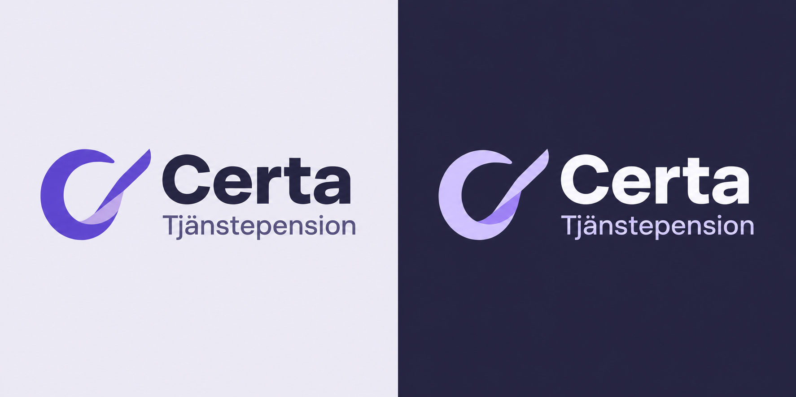

# Idélista – eventuellt att göra

Idéer att ta upp när de blir aktuella. Prioritet och utformning avgörs då.

## Chattrum för agenternas samarbete

När agenter behöver samarbeta kan operatören öppna en chattvy för ärendet eller
uppdraget. Där går det att följa vem som skickade en fråga eller lämnade över en
uppgift till vem, vilket underlag som skickades med och vilket svar som kom
tillbaka. Historiken går att öppna även efter att arbetet är klart.

## Visa när en agent arbetar

När någon skickar ett uppdrag till en agent kan gränssnittet visa en liten
aktivitetsikon medan arbetet pågår. I handläggargränssnittet kan den exempelvis
sitta vid agentknappen eller chatten i ärendet. En kort statustext kan visa det
aktuella steget, till exempel ”Hämtar premiehistorik” eller ”Väntar på svar från
aktuariens agent”. Samma idé kan användas i andra gränssnitt där agenter arbetar.
Ikon och placering bestäms när respektive gränssnitt utformas.

## Certa som möjligt namn för bolaget och projektet

Vilande namnförslag. Om operatören aktiverar namnbytet används **Certa** för
både bolaget och projektet, med **Tjänstepension** som underrad i logotypen.

Använd bilden nedan som förlaga för logotypfilerna vid ett namnbyte. Den valda
versionen vidareutvecklar Geminis idé med ett öppet C. Diagonalen växer fram ur
C:ets nedre kurva och en andra indigoton markerar svängen. Ordmärket sätts i
DM Sans Bold (700). [Digital klarhet](../06_design/designsprak.md)

- **Ljus grundversion (vänster).** För webb och dokument. Indigo (`#6951CF`)
  och mörkt ordmärke (`#252440`) på den ljusa bakgrunden (`#EEEDF6`).
- **Mörk version (höger).** För exempelvis titelbilder. Ljus indigo (`#D2C5FF`)
  och ljust ordmärke (`#F4F2FF`) på mörk indigo (`#252440`).

