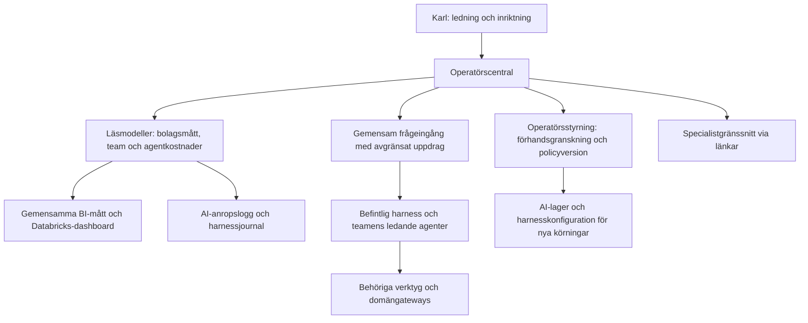

# Operatörscentral – arkitektur och planerade kontrakt

> **Datum:** 2026-10-25, uppdaterat 2026-10-26. **Status:** beslutad design och
> första lokala läsleverans OC-1/OC-2. Styrning och fullständig integration återstår;
> inga styrinställningar eller databasändringar i Lakebase är aktiverade.
> Produktägande och byggpaket: [Projekt 10](../projekt/10_operatörscentral/PROJEKTPLAN.md).

> **OC-0, 2026-10-26:** [Beslutsförslag med val A–X](operatörscentral_beslutsforslag.md)
> preciserar mått, händelser, eskaleringar, routing, autentisering och gemensam
> modell-/budgetpolicy för OC-5 och 3b-9. Rekommendationerna A–X är godkända
> genom B-038. Styrimplementationen återstår; dagens konfiguration och befintliga behörighetsvägar består.

> **OC-1/OC-2, 2026-10-26:** första lokala läsleveransen finns på `/central`:
> bolagsmått, team, kostnader och underlag. [Driftbeskrivningen](operatörscentral_drift.md)
> skiljer byggda läsadaptrar från kvarstående fullständig logg-/BI-integration
> och styrning. Ingen ändring av dagens runtimepolicy eller behörigheter ingår.

> **Planeringsprioritet 2026-10-27:** operatören har godkänt dokument- och
> prioriteringsändringarna efter riktningsgranskningen. Nästa bygguppdrag att
> förbereda är den avgränsade beståndsfrågan till granskad rapport i
> [projekt 10](../projekt/10_operatörscentral/PROJEKTPLAN.md), med projekt 2,
> aktuarieteamet och gemensam dokumentgenerering. Startvillkor och acceptans
> finns där. Frågeingången och rapportkedjan är inte implementerade genom detta uppdrag.

## 1. VD-nivå och specialiserade arbetsytor

Centralen samlar bolagets läge, teamens leveranser och kostnader, analysfrågor
och inriktningsbeslut. Enskilda handläggarärenden och deras godkännanden
stannar i specialistgränssnitten. En sammanlagd avvikelse kan motivera en
ledningsfråga, exempelvis ett återkommande kvalitetsproblem eller en budgetavvikelse.
Väsentlighet, tidsfönster och ansvarig måste preciseras; inga automatiska
eskaleringströsklar införs genom planen.

**Plattform med teamområden.** Centralen är startsidan i en gemensam
webbplattform, där varje team har ett eget område. Försäkringsteamets område är
dagens handläggar-UI. Compliance, aktuarie och senare team får egna områden.
Ett område exponerar bara teamets egen agent, och centralen länkar till alla
områden och visar deras läge. Arbete över flera team startas härifrån som flöden
(B-036; OC-7, OC-8 i [projekt 10](../projekt/10_operatörscentral/PROJEKTPLAN.md)).

En ledningsfråga ska innehålla frågeställning, period, ansvarigt team,
underlagsreferenser, alternativ, konsekvenser, osäkerhet och föreslagen
uppföljning. Att Karl väljer en inriktning verkställer inte automatiskt en
försäkringsändring, ett utskick eller en kapitaltransaktion.

## 2. Gränser och återanvändning

Pilarna beskriver målbilden. Frågeingång, sammanställningar och styrväg är ännu
inte implementerade. Flödesmotorn 3c-2 finns på main `66d1add`; 3c-1-delegering,
VD-routning, 3b-9-inställningsvy och BI-dashboardens drift återstod vid planstart.
Delegeringen finns sedan 2026-10-27 (B-039) men används ännu inte av någon frågeingång.
Det första flödet, `rule_change_parameter`, och dess UI `/floden` kom i 3c-3.
UI:t ligger tillfälligt i handläggar-UI:t, och flyttar hit i OC-7 (se nedan).

- Återanvänd FastAPI/Jinja2/HTMX och Digital klarhet. Ingen ny frontendplattform
  krävs. Ett separat navigationsområde för ledning är ett designförslag;
  befintliga specialistvyer behåller sina arbetsflöden.
- B-029 består: projekt 2 äger granskade BI-mått och dashboard i Databricks.
  Centralen sammanfattar eller bäddar in samma underlag; ingen andra måttmotor.
- `src/services/` äger försäkringssystemet. Modellpolicy, budget och
  ledningsuppdrag får inte läggas där som generella bolagsoperationer.
  De får en egen betrodd operatörsväg till rätt konfiguration/gateway.
- Ingen generell SQL-, fil-, shell- eller nätverksåtkomst introduceras för
  chattens modeller. Befintliga scopes, PII-gränser och godkännanden gäller.
- **Flöden och produktparametrar hör hemma här (OC-7).** En regeländring är ett
  beslut på bolagsnivå och inte handläggning av enskilda försäkrade.
  - Arbetsytan byggs för ordinarie verksamhetsuppdrag med aktuella källor och
    underlag. B-035:s specifika scenario och skriptade modell är teststöd;
    ingen hårdkodad demo-knapp byggs in i centralen. Före integration behöver
    scenariobundna antaganden skiljas från återanvändbara funktioner.
    Se MASTER_CONTEXT §1 (operatörens förtydligande 2026-10-25).
  - Centralen når flödena genom adaptern `agents.flows.console.FlowConsole`,
    precis som handläggar-UI:t gör i dag. Motorn och definitionerna i
    `src/agents/flows/` ändras inte vid en flytt.
  - Flöden startas och drivs härifrån med samma operatörsidentitet och
    formulärskydd som handläggar-UI:t (B-017). Kravet på autentisering i §7
    gäller styrvägen för modellpolicy och budget, inte flödenas steg.
    Flödenas egna skydd består: version, bunden hash och godkännandekön.
  - Grindarna ersätter inte godkännandekön (`harness.md` §4.2). Förslag som gäller
    bolagsbeslut, till exempel en ny parameterversion, visas här, men kön ägs
    fortfarande av tjänstelagret och förslagen avgörs genom `ServiceLayer.approve/reject`.

## 3. Data för bolagsläge och team

Varje mått behöver stabilt id, definition, enhet, population, datum/period,
datakälla/miljö, beräknad tid, modell-/grundversion, ägare, underlagsreferenser
och status: utfall, prognos, scenario, ej beräknat, saknas eller inaktuellt.
Designgodkända scheman, första måttdefinitioner och separata statusfält finns i
[OC-0 §3](operatörscentral_beslutsforslag.md#3-måttkontrakt--bf), B-038.
Läsadaptrar och kontroller verifieras med projekt 2. Olika miljöer och perioder
summeras inte ihop. Diagram och chatt använder samma måttkontrakt.

Konsolidering visas först när tillämplig fördelnings-/återbäringsmodell,
värdering och periodunderlag är definierade och verifierade av rätt område.
Premiehistorik kan inte ersätta kapitalvärdering eller åtagandeberäkning.
Saknat underlag visas som **ej beräknat**, inte som noll eller en uppskattad kvot.

Teamöversikten skiljer planerat team, konfigurerad profil, pågående uppdrag,
väntan, avslutad leverans och fel. Lagrade körningar och senaste uppdatering
är underlag; avsaknad av körningar bevisar inte att teamet fungerar felfritt.
Detaljerna är uppdrag och teamresultat, inte person-/ärendeuppgifter.

## 4. Agentkostnader och nytta

Utgå från `CallRecord` i `src/ai/tracing.py` och harnessens körjournal.
Sammanställ per period, team, agent, leverantör, modell och uppdrag. Visa
förbrukning mot beslutad budget samt färdiga leveranser, kvalitetskontroller,
fel och väntan som förklaring. Föreslagna nyttomått kräver en tydlig definition;
en billig eller avslutad körning är inte automatiskt korrekt.

- Anropskostnader är uppskattningar enligt versionsbundet prisunderlag,
  inte en avstämd leverantörsfaktura. Belopp visas i USD; eventuell SEK kräver
  explicit kurs och kursdatum.
- Fel-/reservförsök räknas när kostnad är känd. `cost_usd = null` redovisas
  som okänd kostnad med antal berörda försök, aldrig som kostnadsfritt.
- Aggregera ursprungliga anropsposter en gång. Summera inte samtidigt ett
  rotresultats ackumulerade belopp och barnens/fortsättningarnas belopp.
- Kopplingen mellan anrop, körning och uppdrag måste vara stabil. Definiera
  deduplicering/import-id, prisversion och täckning innan en varaktig loggimport byggs.
  Dagens `CallRecord` saknar ett generellt eget händelse-id/prisversionsfält.
- Visa loggarnas täckning och färskhet. Saknade loggar ger okänt underlag.
  Exponera inte rå prompttext, personuppgifter eller nyckelvärden i ledningsvyn.

## 5. Fråga bolaget genom en gemensam ingång

Den samordnande ingången är en funktion i operatörsytan, inte en självständig
VD-agent med nya rättigheter. Förslaget preciserar B-026:s teamingångar:

1. Bind fråga, period, miljö och utpekade mått till ett avgränsat uppdrag.
2. Föreslå ansvarigt team och gör routing spårbar; fråga Karl om ett avgörande
   val är oklart. Teamets ledande agent tar emot uppdraget.
3. Kontrollera att profil och verktyg är byggda. En fråga till ett obyggt team
   blir inte en låtsaskörning. En fråga utökar aldrig databehörighet.
4. Samla ett svar med slutsats, källor/beräkningar, period, ansvarigt team,
   antaganden, osäkerhet, körreferenser och kostnad. Språklig sammanställning
   får inte beräkna nya ekonomiska tal eller dölja motstridiga teamsvar.
5. Flera team kräver 3c-1 med barnreferenser, gemensam rotbudget och djup-/antalstak.
   Kända processer återanvänder flödesmotorn. Första leveransen kan rikta ett
   uppdrag till ett uttryckligen valt team utan automatisk delegering.

Genie är den planerade datafrågeförmågan över granskade BI-underlag enligt
B-029. Det är ett verktyg bakom ingången, inte dess ersättare eller en fri väg
till modeller/operativa data. Integration och åtkomst granskas i projekt 2.

## 6. Global modellpolicy och budget

AI-lagret har rollerna `fast`, `standard` och `deep`, primär-/reservmodeller
och konfigurations-/miljööverstyrning. Det har ännu ingen styrpanel som
varaktigt aktiverar en global operatörspolicy. Planerad styrning:

| Val | Avsedd effekt |
|---|---|
| Blandad policy | Godkända primär- och reservmodeller per roll används |
| Föredra OpenAI / Anthropic | Roller får validerade primärmodeller hos vald leverantör; annan leverantör som reserv kräver uttryckligt val |
| Endast OpenAI / Anthropic | Hela tillåtna modellkedjan begränsas till vald leverantör; även reserv och anrop med explicit modellreferens kontrolleras |
| Teamundantag | Synliga, granskade avvikelser från global policy; förhandsgranskningen visar varför ett team inte följer huvudvalet |

Före aktivering visar centralen berörda team/roller, effektiva modeller,
reservpolicy, förmågestöd, konfigurationsversion och förväntad prisförändring
när jämförbart underlag finns. Ändringen valideras även mot strukturerade
svar och verktygskontrakt. Ett leverantörsval garanterar inte likvärdig kvalitet.

En inställning har **en auktoritativ källa**. [OC-0 §8](operatörscentral_beslutsforslag.md#8-en-auktoritativ-modell-budgetpolicy--rw)
beskriver ett gemensamt policyregister för OC-5 och 3b-9, med kontrollerad
övergång från dagens YAML/env. Designen är beslutad genom B-038 men ännu inte införd; ingen dold överstyrning eller
separat kopia i UI:t. Aktiv konfiguration och eventuell env-överstyrning ska
gå att förklara. API-nycklar ligger kvar utanför repot och visas aldrig.

Nya rotkörningar använder aktiverad version. Pågående rotkörningar, barn och
länkade fortsättningar behåller sin version och sin återstående budget.
Återställning skapar en ny aktivering av tidigare granskad konfiguration;
historiken skrivs inte om. Logga aktör, tid, skäl, tidigare/ny version och utfall.

Körgränser återanvänder 3b-9:s planering. Periodbudget per team, varning och
spärr mot nya uppdrag är separata funktioner från dagens körbudget och kräver
budgetbok/reservation vid samtidiga körningar. Inga hårda månadsbudgetar eller
avbrott av pågående modellanrop utlovas av den befintliga motorn.

## 7. Skrivväg, verifiering och införande

Läsbar överblick införs först. Styrning kräver autentiserad Karl,
serverkontrollerad behörighet, formulärskydd, validerad förhandsgranskning,
versionskontroll och ändringslogg. Dagens lokala handläggaridentitet är inte
tillräcklig autentisering för att aktivera den nya styrvägen.

Verifieringen ska omfatta avstämda kostnadsexempel, saknade ekonomiska mått,
begränsad routing, avvisade otillåtna uppdrag, exklusiv leverantörspolicy,
teamundantag, samtidiga aktiveringar, bevarad policy under en rotkörning och
att handläggarärenden inte flödar in som VD-beslut. Kör FakeProvider- och lokala
prov först; separata godkända integrationer verifieras när de byggs.

Planen återanvänder B-017/B-025/B-026/B-028/B-029/B-034/B-035. Ingen ny agent,
databasroll, åtkomstrad, extern tjänst eller produktregel införs genom texten.
