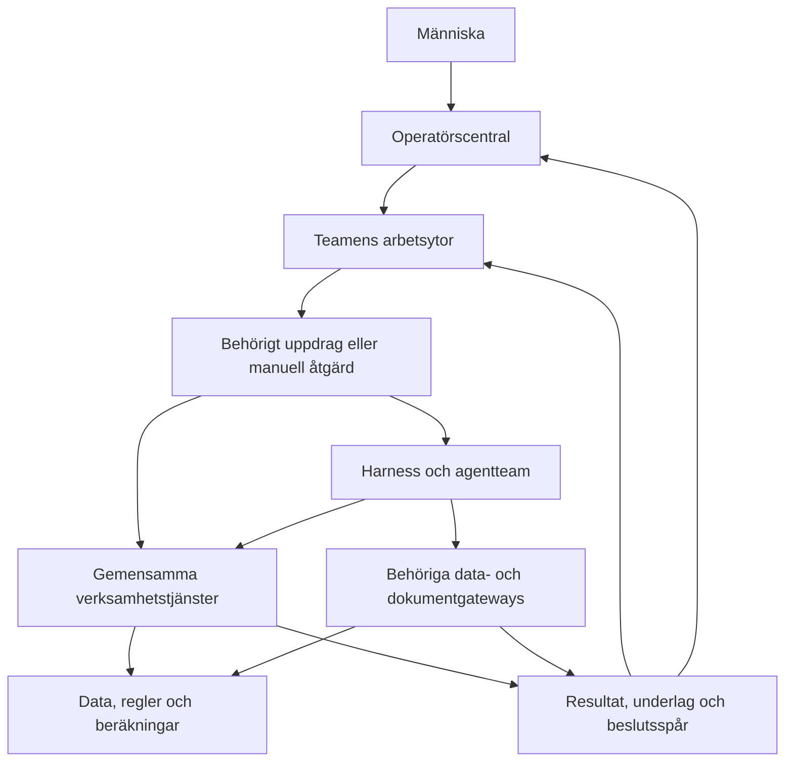

# Riktningsgranskning – företaget, människorna och agentteamen

> **Datum:** 2026-10-27 | **Status:** Analys och rekommendationer för operatörens ställningstagande.
> **Granskat kodläge:** `fed74ae592a22297a81f88c87ac945f69a05e76e`, hämtad `origin/main`.
> **Uppdrag:** Pröva projektets riktning mot Karls beskrivning i chatten av ett företag där
> människor och AI arbetar tillsammans eller självständigt genom gemensamma system.
> Dokumentet beslutar ingen ny prioritering, produktregel, behörighet eller arkitektur.

## 1. Bedömning och rekommendation

**Grundriktningen är förenlig med målbilden. Den största risken är att fler delar blir
tekniskt färdiga utan att de bildar ett sammanhängande arbetssätt och en fungerande
verksamhet.** Någon generell ombyggnad av tjänstelager, teammodell eller harness
motiveras inte av denna granskning.

De senaste leveranserna har byggt verkliga förutsättningar: avgränsade agentmandat,
gemensamma operationer, kontrollerade parameterändringar, teamdelegering,
ledningsöverblick och rapport-/presentationsmallar. Dessa bidrar på olika avstånd
från verksamhetsnyttan. En mall underlättar leveransen; en fungerande tjänsteoperation
utför ett verksamhetssteg; ett helt arbetsförlopp behöver båda och deras kopplingar.

Två slags sammanhang behöver nu få större vikt vid val av arbete:

1. **Människans och teamets arbetsförlopp:** initiera eller ta emot ett uppdrag,
   avgränsa det, utföra arbetet, samverka vid behov, granska, besluta, leverera och
   hitta resultatet senare. Centralen och teamytorna ska göra detta begripligt.
2. **Företagets verksamhetsförlopp:** kundadministration, premie och betalning,
   kapital och garanti, förvaltning, pension, ekonomi, aktuariell värdering och
   rapportering. Här återstår flera grundläggande motorer och avstämningar.

**Rekommendation:** välj nästa leveranser efter vilka luckor de stänger i dessa
förlopp. För vidare användning av den byggda grunden föreslås en avgränsad första
fråge-/leveranskedja genom central och teamyta. Samtidigt behöver premie- och
betalningsflödet få ett samordnat bygguppdrag och FTA ett eget värderings- och
förklaringskontrakt. Detta är tre kopplade behov, med olika beroenden; hela företaget
behöver inte bli färdigt innan ett avgränsat arbetsförlopp kan användas.
Välj en första byggleverans. De andra behoven ska få tydliga kommande uppdrag,
inte bli ytterligare samtidiga starter genom den här granskningen.

## 2. Vilken målbild granskningen använder

Karls beskrivning tolkas som övergripande krav på hela företaget. Exemplen med
beståndsfrågor, FTA och regeländringar är representativa användningar, inte en
uttömmande lista över teamens arbete eller särskilda demonstrationsbeställningar.

| Målbild | Vad som behöver kunna visas i en fungerande leverans |
|---|---|
| Arbetsgivare och försäkrade hanteras genom hela sina förlopp | Sammanhängande operationer, kundunderlag, avvikelser, betalningar, besked och uppföljning |
| Externa förändringar omsätts snabbt och kontrollerat | Källa, konsekvenser, berörda regler/system/processer, beslut, genomförande och verifiering hålls samman |
| Team utför eget arbete och samarbetar | Avgränsat uppdrag, ansvarigt team, tillåtna verktyg, mottagande teams mandat och återförda resultat |
| Människor och agenter arbetar med samma företag | Samma verksamhetsoperationer och identifierbara underlag/resultat, med olika behörigheter där det behövs |
| Alla teamytor nås från centralen | Navigation och synlig förmågestatus samt vägar för att initiera, följa och återfinna arbete |
| Frågor får underbyggda svar i rätt form | Behörig dataväg, definierade mått, verifierade beräkningar, källor, begränsningar och rapport/presentation i Digital klarhet |
| Strategiska beslut får analysstöd | Baslinje, alternativ, antaganden, effekter, osäkerheter och ett beslut som kan följas upp |
| Företaget kan arbeta självständigt inom sitt mandat | Utlösare, körning, varaktig status, hantering av väntan/fel och tydliga eskaleringar till människan |

Detta utvecklar användningen av B-017, B-026, B-028, B-034 och B-036–039.
Produktscope ITP1 ålderspension och sandboxens begränsningar består. Mer detaljerade
teammandat hämtas ur befintliga dokument. Oklara mandat blir uttryckliga
utredningspunkter, inte antagna nya befogenheter.

## 3. Underlag och metod

Granskningen omfattar de tre styrfilerna, samtliga tio projektplaner,
de tio agentbeskrivningarna, processöversikten, delar av harness-/BI-/
centraldokumentationen och implementationens relevanta ingångar. Särskilt har
körpolicy, webbroutes, agentuppdrag, delegering, parameterflöde,
dokumentgateway, ledningsmått och lokala exportmallar jämförts med beskrivningarna.

Följande skiljs åt i bedömningen:

- **Beskrivet/beslutat:** mandat, regelunderlag eller design finns.
- **Byggt:** en identifierbar implementation finns inom angiven avgränsning.
- **Lokalt verifierat nu:** befintliga riktade tester har körts i denna granskning.
- **Tidigare verifierat:** en dokumenterad körning finns; den har inte upprepats här.
- **Sammanhängande verksamhetsförmåga:** hela det aktuella förloppet fungerar med
  underlag, kontroller, resultat och uppföljning. Det följer inte automatiskt av
  de andra nivåerna.

Granskningen är ingen fullständig kod-, säkerhets-, tariff- eller regelverksrevision.
Inga externa konton, modeller, Databricks-anrop, Lakebase-skrivningar eller
regelaktiveringar har gjorts. Frånvaro av en förmåga bedöms från både körpolicy,
operationer och projektens uttryckliga luckor; en textsökning ensam är inte bevis.

## 4. Teamen och företagets funktioner

Sju team och tio agentroller är beskrivna. Körpolicyn har tre aktiva
agentprofiler: handläggare, compliance och aktuarie. En namngiven roll eller
ett team i organisationskartan innebär därför inte ett körande team.

| Team | Ansvar i målbilden | Byggd grund | Viktigaste kvarstående förmåga |
|---|---|---|---|
| Försäkring och kund | Arbetsgivare, försäkrade och försäkringsärenden | Tjänsteoperationer, handläggarvy, ärenden och agent för `salary_report` | Bredare intag, livscykel, premie-/betalningskedja, kommunikation och självständiga uppdrag |
| Aktuarie och analys | Aktuariella underlag, antaganden, risk och analys; Data scientist som planerad specialist | Profil, avgränsad premieeffektanalys, regel-/parameterläsning och mottagning av delegerade uppdrag | Garanti-/reserv-/FTA-/ALM-motorer, bredare analysverktyg och egen teamyta |
| Compliance och rapportering | Regelkunskap, tolkning och styrdokument; Rapporteringsagent som planerad specialist | Källäsning, utkast, strukturerad parametertolkning, parameterflöde och delegering till aktuarie | Källbevakning, generell genomförandekedja, rapportkontrakt och rapporteringsfunktion |
| Kapitalförvaltning | Värdering, allokering, limiter, likviditet och avstämning | Lokalt testade portfölj-/affärsmodeller och dokumentutkast | Antagna förvaltningsunderlag, data, beräkningar, operationer, agent och arbetsyta; ingen aktiverad handelsfunktion |
| Ekonomi och inköp | Bokföring, budget, likviditet, bokslut och leverantörsunderlag | Agentmandat och identifierade behov i projekt 6 | Ekonomisk huvudbok/avstämning, rapportunderlag och körbara roller; inköpsarbete är också planerat |
| Kommunikation | Kanaler, kund-/intressentkommunikation och gemensamma mallar | Lokal rapport- och presentationsexport; ägarskap för framtida gemensamma genereringsskills är beskrivet | Körbar profil, behöriga kundunderlag, besked, godkänd sändning, leveranskvitton och teamyta |
| Utveckling och plattform | Kod-/dataförändringar, integrationer och driftsstöd | Plattformskod och harness finns som byggda systemdelar | En körbar utvecklaragent med avgränsat ändrings-/test-/releasearbete och egen arbetsyta |

Codex och Claude som bygger repot ska inte räknas som en implementerad
utvecklaragent i det simulerade bolaget. På motsvarande sätt är lokal
rapportexport inte en aktiverad kommunikations- eller rapporteringsfunktion.

Risk, kontroll och internrevision måste också få täckning. Aktuarie-, compliance-
och rapporteringsmandaten täcker delar av området, men metod, oberoende granskning,
driftansvar och rapportmottagare behöver preciseras för relevanta leveranser.
Det innebär inte att nya agentroller eller team behöver skapas nu.

## 5. Hur lagren hänger ihop

Följande är en tolkning av beslutad riktning, inte en nulägeskarta över färdig drift:



Här finns redan flera bärande delar. Det som saknas mest är kopplingen mellan
ett verksamhetsuppdrag, dess utförande och människans samlade arbetsvy.
Alla arbetsytor nåbara från centralen betyder inte att allt detaljarbete eller
alla godkännanden ska flyttas in i VD-vyn. Specialistytorna och domänköerna
behåller sina uppgifter enligt B-036/B-038.

## 6. Viktigaste fynden

### R-01. Arbetsförloppet genom central och teamyta är inte sammanbundet

**Belägg:** centralens mall säger uttryckligen att inga agentuppdrag eller
styrändringar startas där. Bara försäkringsteamet har länk till en befintlig
arbetsyta; övriga hänvisar till OC-8. OC-3 och OC-7/8 beskriver den återstående
kopplingen. Ärendeytan kan redan starta handläggaragenten. [E3–E5]

**Betydelse:** användaren kan se delar av läget, men saknar den gemensamma
vägen från en fråga till ansvarigt team, underlag, beslut och återfinnbar leverans.

**Rekommendation:** börja med ett valt team och en avgränsad fråga genom de
befintliga ingångarna, enligt OC-3:s stegvisa införande. Automatisk routing mellan
alla team behövs inte för den första leveransen. Återanvänd `task_id`, ärende-, körnings-, flödes- och utkastreferenser
där de passar; deras olika syften ska behållas. En gemensam läsprojektion och
tydlig livscykel kan knyta ihop dem. Granskningen föreslår ingen ny allmän runtime
eller ersättning för ärendesystemet.

Nya bolagsfrågor följer B-038:s verifierade operatörssession och rättigheter.
Befintliga flödesåtgärder genom `FlowConsole` behåller B-036:s domänväg och
ska inte ges ett nytt beroende till OC-5:s framtida styrfunktioner.

### R-02. Verksamhets- och värderingsmotorer är stora flaskhalsar

**Belägg:** registrering av löneunderlag skapar ingen premie. Kapitalet i
försäkringsöversikten summerar betalda premietransaktioner. Processöversikten
identifierar luckorna i fakturering, betalning, kapitaljournal, pension och
bokföring. Aktuariell grund anger uttryckligen att garantivärdet `V_g` inte
är FTA och att skuldvärdering behöver en separat grund. Centralens FTA-mått
är ej beräknat. [E6–E8]

**Betydelse:** fler agentverktyg och rapportytor kan inte ensamma ge ett
fungerande pensionsföretag eller ett verifierat svar på varför FTA förändrats.

**Rekommendation:** konkretisera befintligt paket A med ansvar, kontrakt och
avstämningsfall. Avgränsa samtidigt vad den första aktuariella värderingen ska
omfatta: ändamål, population, datum, kassaflöden, grundversioner, avstämning,
granskning och förklaring av förändring mellan perioder. Värderingsgrund och
beräkningsmetod måste vara bestämda innan resultat benämns FTA. Produktens
garantitariff får inte användas som en automatisk ersättning.

### R-03. Generell analys och strategiskt beslutsstöd återstår

**Belägg:** byggd beståndsinsikt gäller ett godkänt parameterförslag. Den
delegerade aktuarien får i första paret inget parametermandat; verktyget för
beståndsinsikt är då dolt. Projekt 2 anger att dashboard-/Genie-integration,
dataväg och bredare agentanalys återstår. [E2, E9]

**Betydelse:** en lyckad compliance–aktuarie-delegering visar samarbete inom
avgränsade verktyg. Den visar inte att centralen kan besvara en valfri komplex
beståndsfråga eller analysera ett strategiskt beslut.

**Rekommendation:** välj först några relevanta beståndsfrågor och definiera
gemensamma mått, behörig dataväg, källversion och kvalitetskontroll. Återanvänd
analysfunktioner där definitionerna passar. Lakebase-åtkomst, Databricks BI och
Genie ska hållas isär som förmågor; deras faktiska koppling behöver verifieras.
Ge inte modellen fria databasskrivningar eller öppet SQL-mandat för att stänga glappet.

Strategiska underlag behöver skilja baslinje, alternativ, antaganden,
genomförbarhet, effekter och osäkerheter. Ett scenario är ett analysunderlag;
produkt- eller investeringsbeslut har fortsatt sina egna beslut och kontroller.

### R-04. Självständigt arbete är ännu främst en målbild

**Belägg:** handläggaragenten startas från ärendet och kör synkront. Delegering
är också synkron och sekventiell. Bakgrundsarbetare och F5-7 är öppna uppgifter.
Körstatus och budgetkontroller finns redan. [E4, E10]

**Betydelse:** en agent kan genomföra flera steg inom ett uppdrag, men företaget
har ännu inte en generell ordning för att själv ta emot, starta och återuppta
vardagsarbete. Att vara modellstyrd under en körning är en annan förmåga än
att verksamheten löper självständigt över tid.

**Rekommendation:** koppla bakgrundskörning till ett definierat verksamhetsfall
med utlösare, ansvar, varaktig status, väntan, återhämtning och uppföljning.
Pröva vilka beslut människan behöver se och vilken arbetsvolym detta ger.
Ändra inte befintliga godkännandekrav som en genväg till ökad självständighet.

### R-05. Resultat och kunskap behöver bli en mänsklig arbetsyta

**Belägg:** utkast sparas per team och körning med manifest och kontrollsumma;
flödesvyer kan läsa utkast och journaler. Den allmänna journalen sparar känslig
fri text som hash och längd. Centralen saknar leverans-/kvalitetsmått och bred
dokumentvy. PDF-mallarna är lokala bibliotek; genereringsskills är planerade.
[E3–E5, E11–E12]

**Betydelse:** teknisk spårbarhet finns, men den ger ännu inte hela den
begriplighet och sökbarhet Karl efterfrågar. Ett påstående om slutförd körning
är inte bevis för en godkänd leverans. En utkastfil är inte automatiskt en
gällande regel eller ett återfinnbart beslutsunderlag.

**Rekommendation:** definiera hur människor hittar uppdrag, lästa källor,
motivering, beräkningsunderlag, versionerad leverans och granskningsstatus.
Visa begripliga, behöriga sammanfattningar och verifierbara referenser;
öppna inte råa konversationsloggar för att förklara agenternas arbete.
Koppla gemensam rapport-/presentationsexport till behörig lagring och samma
arbetsförlopp. En gemensam utkast-/leveransvy ska inte kunna ändra gällande
dokument eller publicera genom att en fil råkar finnas där.

### R-06. Prioriteringsunderlaget beskriver många behov men ger svag vägledning mellan dem

**Belägg:** backloggen innehåller flera samtidiga högprioriterade tekniska,
visuella och verksamhetsmässiga spår. Projekt 6 samlar ekonomi och aktuariella
behov men har ännu inga avgränsade bygguppdrag för hela området. Processöversikten
har redan gap-ID:n och förslag till paket. [E1, E6, E13]

**Betydelse:** det går att välja en relevant uppgift och ändå lämna samma
avgörande verksamhetsglapp öppet efter många leveranser. Underlaget stödjer
den risken; granskningen bevisar inte att varje tidigare prioritering varit fel.

**Rekommendation:** använd befintliga projekt, OC-paket och V-/S-gap för nästa
prioritering. Ange för varje bygguppdrag vilket arbets- eller verksamhetsförlopp
det förbättrar, beroenden, ansvarig och konkret godkänt resultat. Inför inte
ett nytt övergripande ramverk eller ett elfte projekt för att hålla reda på detta.

## 7. Fem förlopp att pröva riktningen mot

Förloppen är acceptansfall för ordinarie förmågor. De beställer inga
hårdkodade demoknappar eller scenariobundna datamodeller. Normalfall, avslag,
saknat underlag och avvikelser behöver prövas där de är relevanta.

| Förlopp | Finns att bygga vidare på | Saknade länkar | När ett avgränsat resultat kan godtas |
|---|---|---|---|
| Beståndsfråga från central till rapport | Centralens läsgrund, tjänstelager, premieanalyser, körmandat och mallar | Frågeingång, bredare analysverktyg, teamyta och lagrad granskad leverans | Vald fråga får ett källbundet svar med period, population, definitioner, begränsningar och återfinnbar rapport; ej stödbar fråga avgränsas tydligt |
| Extern regeländring till verifierad åtgärd | Källäsning, tolkning, parameterflöde, mänskliga grindar och delegering | Källbevakning och samordnat genomförande för andra typer av påverkan | Påverkan bedöms från källan; tillämpliga regler, kod, processer och besked hanteras spårbart; ändringar utanför byggt stöd lämnas öppet för vidare arbete |
| Aktuariell värdering till förklaring av FTA | SIM-underlag, parameterregister, aktuarieroll och planerat mått | Separat värderingsgrund, motor, bestånd/kassaflöden, kontroll och rapportkontrakt | Avgränsad värdering kan återskapas; förändring kan förklaras och stämmas av utan att garantivärde eller premievolym kallas FTA |
| Arbetsgivarunderlag till avstämd mottagen premie | Register, löneunderlag, förhandsberäkning, ärende och agentförslag | Ordinarie premie, faktura, bankmatchning, avvikelse och koppling till kapital/garanti | Normalfall och avvikelser ger spårbara utfall och inga dubbla ekonomiska effekter; kvarvarande led redovisas |
| Strategiskt vägval till analys och uppföljning | Teammodell, avgränsade analyser, beslutsspår och ledningsdesign | Bredare effektmodeller, samordnat uppdrag och beslutad uppföljning | Baslinje och alternativ jämförs med verktygsstödda resultat där stöd finns; begränsningar, beslut och uppföljningsmått är tydliga |

Kundärenden och kommunikation, pensionsförlopp, kapitalförvaltning, ekonomi,
inköp, drift och kontroll omfattas också av företaget. Deras mandat framgår av
§4 och deras beroenden av befintliga projektplaner. De fem fallen är valda för
att pröva flera lager och team; de begränsar inte bolagets totala uppdrag.

## 8. Rekommenderad prioritering att ta ställning till

| Prioritet | Konkret nästa leverans | Återanvändning och beroenden | Föreslagen samordning |
|---|---|---|---|
| Först | Välj och avgränsa första fråge-/leveranskedjan; bygg därefter hela den avgränsade vägen | OC-3 och berörd del av OC-8, befintligt team och granskade analysmått, B-038:s identitetskrav, gemensam dokumentgenerering | Projekt 10 tillsammans med 2, berört team och mallarnas ägare |
| Samordnat verksamhetsbygge | Bryt ned paket A till ett kontrakt och en första genomförbar premie-/betalningsleverans | V-01–03, beslutade produktregler, löneunderlag och premiemotor; tydligt gränssnitt till kapital/garanti och ekonomi | Projekt 1/4/6 med projekt 5 vid kassaflödesgränsen |
| Tidig aktuariell avgränsning | Bestäm första värderingens ändamål, grund, population, kontroller och förklaring | V-11/12, projekt 6 och 2, beroenden till kapital-/pensionsdata redovisas före implementation | Aktuarie med ekonomi, kapital och rapportering där deras underlag behövs |
| Fullfölj byggda förmågor | Slutverifiera ärende-/parameterflöden inom gällande datum och mandat | F5-5/6 och 3c-V, dokumenterade roller och flödestabeller; framtida regelgiltighet får inte kringgås | Befintliga ansvariga byggspår; inga nya databasåtgärder genom denna rapport |
| När ett konkret självständigt arbetsfall är valt | Varaktig kö/bakgrundskörning med återhämtning och mänsklig uppföljning | F5-7 och harnessens befintliga uppdrags-/budget-/journalmekanismer | Harness, ansvarigt verksamhetsteam och dess arbetsyta |

Ordningen är en rekommendation, inte ett startbeslut eller en uppmaning att
köra parallellt utan beroendegranskning. Pågående arbete avbryts inte av rapporten.
De första tre radernas designbehov kan samordnas, men implementation behöver
avgränsas mot delade modeller och kontrakt enligt AGENTS.md.

Följande kan normalt vänta tills de stöder en vald verksamhetsleverans:

- Fler agentprofiler utan verktyg och ett konkret uppdrag.
- Ytterligare generell delegering utan ett nytt samarbetsbehov.
- Nya allmänna malltyper och visuell detaljpolering utöver vad vald leverans kräver.
- Bredare kostnads-/styrfunktioner utöver nödvändiga kontroller och spår för valt arbete.

Detta tar inte bort dessa behov och upphäver inga beslut. Exempelvis är
autentisering, dataminimering och beslutskontroll fortfarande villkor för de
funktioner som kräver dem.

## 9. Kontrollfrågor för kommande bygguppdrag

1. Vilket arbete för en kund, ett team eller en människa blir möjligt efter leveransen?
2. Vilka gemensamma operationer, data och resultat använder både människa och agent?
3. Vem äger uppdraget, vad får teamet göra och när lämnas det till annan kompetens?
4. Var kan en människa starta/följa arbetet, förstå underlaget, besluta och hitta leveransen?
5. Vilka beräkningar och fakta är verifierade, och vad saknas fortfarande?
6. Vilka normal- och avvikelsefall bevisar resultatet, inklusive korrekt avslag eller utebliven åtgärd?

Svar kan läggas direkt i befintligt bygguppdrag eller projektplan. Det behövs
ingen separat omfattande dokumentprocess för varje liten ändring.

## 10. Dokumentdrift och föreslagna styrfilsändringar

Följande har identifierats men inte rättats i denna granskning:

- **Agentkartan §2:** säger generellt att delegering mellan team ännu inte är
  byggd. Det stämmer inte efter B-039. Behöver avgränsas till det byggda paret
  compliance → aktuarie respektive återstående par och integrationer.
- **ATT_GORA:s designstatus:** säger att presentationsmallen och delar av
  tokenåteranvändningen återstår. Den lokala mallen är nu mergad. Detta är
  tidigare flaggad, känd drift; genereringsskills och gatewaykoppling återstår.
- **Företagsöversikten:** är uttryckligen en daterad ögonblicksbild från
  25 oktober. Den ska läsas som historik och inte användas som dagens
  körpolicy, operationsantal eller integrationsstatus.
- **Projekt 6:** samlar centrala ekonomi-/värderingsbehov, men dess breda
  ursprungliga scope och status behöver konkretiseras när första bygguppdrag väljs.

Föreslagna ändringar för operatörens ställningstagande:

- **ATT_GORA.md:** precisera vald närmaste helhetsleverans med beroenden och
  acceptansvillkor; använd befintliga OC-paket och V-/S-gap. Samordna
  presentationsstatus separat utan att markera kundbrev eller agentexport som klara.
- **MASTER_CONTEXT.md:** komplettera vid behov med människans gemensamma
  arbetsförlopp genom central och teamytor samt skillnaden mellan definierad roll,
  körbar profil och verifierad verksamhetsförmåga. Nuvarande vision behöver
  ingen grundläggande omskrivning för att rymma Karls beskrivning.
- **BESLUTSLOGG.md:** ingen ny post har lagts till. Ett uttryckligt beslut om
  ändrad prioritering eller ett nytt kontrakt kan formuleras separat efter
  operatörens ställningstagande. Rapporten tilldelar inget nytt B-nummer.

## 11. Verifiering i denna granskning

**170 tester passerade** på det angivna kodläget:

```powershell
python -m pytest tests/test_management.py tests/test_web_operator.py tests/test_agents_delegation.py tests/test_agents_flow_rule_change.py tests/test_agents_teams.py tests/test_reporting_presentation.py tests/test_reporting_template.py
```

De täcker bland annat ledningsmått och deras luckor, centralens läsvyer,
avgränsad delegering, parameterflödets beslut/utfall, teammandat och lokal
rapport-/presentationsexport. Tester använder lokala fixtures och
testleverantörer. De bevisar inte fri Databricks-analys, verkliga FTA-värden,
autonom bolagsdrift eller full integration mot externa tjänster.

Det effektiva handläggarverktygsurvalet har också lästs med
`show_agent_profile.py case_handler --date 2026-10-27`. Inventeringen saknar
ärendescope och aktiv teamanslutning, så dess dolda PII-verktyg ska inte
förväxlas med verktygen i en korrekt tilldelad ärendekörning. Skrivverktygens
regelgiltighet från 2026-11-01 ska respekteras i fortsatt verifiering.

Historiska modell-/Lakebase-prov redovisas i backlogg och driftunderlag;
de har inte upprepats här. Inga kodändringar eller nya tester har gjorts.

## 12. Källor och spårbarhet

| Ref | Underlag och granskningspunkt |
|---|---|
| E1 | [MASTER_CONTEXT](../MASTER_CONTEXT.md), [BESLUTSLOGG](../BESLUTSLOGG.md), [ATT_GORA](../ATT_GORA.md); vision, beslut, prioriteringar och kvarstående verifiering |
| E2 | [Körpolicy](../src/agents/ecosystem.yaml), [aktuarie](agenter/aktuarieagent.md), [compliance](agenter/compliance-agent.md), [delegering](../src/agents/delegation.py); aktiva profiler, verktyg och mandatgränser |
| E3 | [Centralens implementation](../src/web/routes/operator.py), [mall](../src/web/templates/operator.html), [driftunderlag](operatörscentral_drift.md); läsvy, teamstatus, saknade mått och begränsningar |
| E4 | [Webbens tjänstekoppling](../src/web/database.py), [ärenderoutes](../src/web/routes/cases.py), [handläggaragent](agenter/handlaggaragent.md); verkliga ingångar, manuell start och flödeskonsol som uttrycklig injektion |
| E5 | [Projekt 10](../projekt/10_operatörscentral/PROJEKTPLAN.md), [OC-0](operatörscentral_beslutsforslag.md), [flödesvyer](../src/web/routes/flows.py); planerade central-/team-/uppdragsvägar och befintliga domänåtgärder |
| E6 | [Processöversikt](../01_domän/processer_översikt.md), [projekt 1](../projekt/01_ärendehantering/PROJEKTPLAN.md), [projekt 3](../projekt/03_kundportal/PROJEKTPLAN.md), [projekt 4](../projekt/04_produktregelverk/PROJEKTPLAN.md); verksamhetskedjor och V-/S-gap |
| E7 | [Löneunderlag](../src/services/operations/salary.py), [försäkringsöversikt](../src/services/operations/insured.py); registreringens avgränsning och dagens kapitalbegrepp |
| E8 | [Aktuariell grund §1](../01_domän/aktuariell_grund.md), [projekt 6](../projekt/06_avdelningsfunktioner/PROJEKTPLAN.md), [ledningsmått](../src/management/metrics.py); åtskilda värderingsbegrepp och saknad FTA-motor |
| E9 | [Projekt 2](../projekt/02_bi_insikter/PROJEKTPLAN.md), [parameteranalys](../src/analytics/parameter_impact.py), [parameterflöde](../src/agents/flows/definitions/rule_change_parameter.py); byggd analys, enparametersgräns och planerad BI-/Genie-koppling |
| E10 | [Harness](harness.md), [uppdrag/resultat](../src/agents/run.py), [ärendekörning](../src/agents/case_runs.py); körmodell, framtida självständigt arbete och befintliga referenser |
| E11 | [Dokumentgateway](../src/agents/gateways/drafts.py), [journal](../src/agents/journal.py), [skillkatalog](../03_skills/skillkatalog.md); utkast, skyddad spårbarhet och planerade genereringsskills |
| E12 | [Rapportmall](../06_design/rapportmall.md), [presentationsmall](../06_design/presentationsmall.md); verklig lokal export med gemensam design |
| E13 | [Projekt 5](../projekt/05_kapitalförvaltning/PROJEKTPLAN.md), [projekt 6](../projekt/06_avdelningsfunktioner/PROJEKTPLAN.md), [projekt 7](../projekt/07_kundchattbot/PROJEKTPLAN.md), [projekt 8](../projekt/08_företagsöversikt/PROJEKTPLAN.md), [projekt 9](../projekt/09_processkartor/PROJEKTPLAN.md); beroenden, samordning och daterade översikter |
| E14 | [Agentkarta](agentkarta.md) och [agentbeskrivningar](agenter/); samtliga tio roller, arbetsdelning och dokumentdrift |

Karls förtydliganden i denna chat är uppdragsunderlag tillsammans med de
versionshanterade källorna. Rapportens prioriteringar och föreslagna kopplingar
är bedömningar från granskningen; de ska inte läsas som redan fattade beslut.
