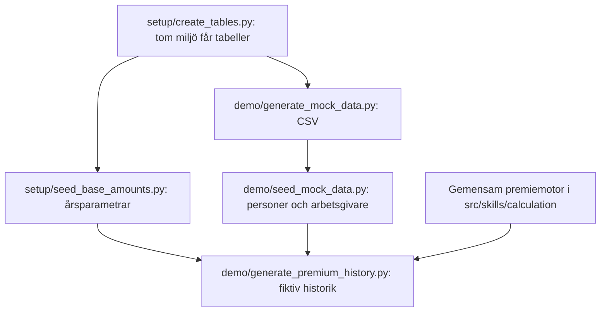

# Kodbas och skriptkatalog

**Tillägg 2026-11-03, P6-MANAD-001:**
`scripts/analysis/prepare_premium_month.py` läser Lakebase skrivskyddat och
fryser ett granskat S-04-paket lokalt. `scripts/analysis/run_premium_month.py`
validerar eller kör det enbart i en isolerad SQLite-fil under `tmp/premium_month/`.
`scripts/migrations/migrate_premium_journal.py` förbereder tre tomma journaltabeller;
körning mot Lakebase kräver separat OK och backup. [Kontrakt och körordning](avstamd_fta_manad.md).

## En kodbas, flera ingångar

Bolagets återanvändbara Pythonkod finns i `src/`. Körverktygen i `scripts/` anropar
denna kod eller förbereder miljö och fiktiva startdata. `tests/` verifierar beteendet.
Det finns ingen separat kodbas per delprojekt eller avdelning (B-015/B-024).

| Område i src | Ansvar |
|---|---|
| models | Databasstruktur: personer, arbetsgivare, försäkringar, lägen, premier, löneunderlag och journaler |
| services | Affärsoperationer, in-/utdata, åtkomst, produktregelkontroll, godkännanden och händelser |
| skills/calculation | Ren ITP1-premieberäkning, återanvänd av operationer och analyser |
| ai | Modellroller, leverantörsadaptrar, strukturerade svar, nycklar och anropslogg |
| analytics | Rena beståndsberäkningar: IBB-scenariot, adapter för offline-backup och konsekvensen av en ändrad produktparameter med undertryckning (`parameter_impact.py`, används av `estimate_parameter_change_impact`, 3c-B) |
| design | Digital klarhets tokenfil (B-034), webbens CSS-variabler som härleds ur den (`web_css.py`) och märket som ikon (`icon.py`) |
| reporting | [Återanvändbar rapportmall i Digital klarhet](../06_design/rapportmall.md), [presentationsmall i 16:9](../06_design/presentationsmall.md) och syntetiska exempel: PDF från Markdown och diagram. Källbundna diagram och rapporter används av [aktuariedialogens arbetsbänk](aktuarie_dialog.md) |
| utils | Databasanslutning, backup/återställning, återanvändbar migrationskod och demobeståndet för handläggar-UI:t, med den äldre kohorten födda 1959–1962 (B-035 val K) |
| web | Handläggar-UI:t (Fas 4): FastAPI-sidor som bara anropar tjänstelagret, och flödena `/floden` genom flödesadaptern, se [handläggar-ui.md](handläggar-ui.md) |
| agents | Harness: körpolicy, skill-register, dispatcher, agentloop, körjournal, ärendekörningar, gatewayerna `regelverk` och `dokument` (`agents/gateways/`, 3c-G), teamen compliance och aktuarie med parametermandat, resultatscheman (`results.py`) och uppdragsmallar (`assignments.py`, 3c-T), flödesmotorn (`agents/flows/`, 3c-2), och flödet `rule_change_parameter` med adaptern för UI:t (`agents/flows/definitions/`, `console.py`, 3c-3). Adaptern kräver uttrycklig AI-klient; det tidigare skriptade demosvaret är borttaget enligt B-037 |
| testing | Testkatalog, ändringsstyrt urval och pytest-markörer; se [teststrategin](teststrategi.md) |
| simulation | Motpartssimulatorn (B-046 PA8): arbetsgivarens löneunderlagsfil och bankens fil ur beståndet, med seed, uttryckliga avvikelser och facit skilt från filen. Läser beståndet och skriver aldrig i affärstabellerna; filerna går genom `import_salary_file` och `import_bank_file` (`counterparties.py`) |
| övriga skill-mappar | Förberedd struktur; ytterligare förmågor byggs enligt fasplanen |

## Var finns körverktygen?

Kör exemplen från repots rot med projektets Pythonmiljö. Alla nedanstående skript
stöder `--help`, som visar användning utan databasanslutning eller AI-anrop.

| Kategori | Skript | Syfte | Sidoeffekt/beroende |
|---|---|---|---|
| testing | [run_tests.py](../scripts/testing/run_tests.py) | Visa grupper eller välj tester efter område/Git-ändringar och beroenden | Planering som standard; `--run` kör lokala tester. `--postgres` tillåter isolerade databasprov enligt AGENTS §4.5. Otestade målområden markeras; se [teststrategin](teststrategi.md) |
| setup | [create_tables.py](../scripts/setup/create_tables.py) | Skapa tabeller som saknas | Skriver schema; uppgraderar inte befintliga tabeller |
| setup | [grant_agent_role.py](../scripts/setup/grant_agent_role.py) | Ge ett agentteams databasroll exakt sina rättigheter (`harness.md` §5.1) | Torrkörning som standard (förkontroll, nuvarande rättigheter, SQL); `--apply` ändrar rättigheter – samordna enligt AGENTS.md §4.5. `--team forsakring` (standard), `aktuarie` eller `compliance`. Rollen skapas av operatören |
| setup | [seed_base_amounts.py](../scripts/setup/seed_base_amounts.py) | Lägg in/uppdatera IBB 2023–2026 | Skriver årsparametrar; tabellen måste finnas |
| demo | [generate_mock_data.py](../scripts/demo/generate_mock_data.py) | Skapa fiktiva personer och arbetsgivare, med den äldre kohorten födda 1959–1962 (B-035 val K) | Skriver CSV, standardmål `data/`; ingen databas. `--older-cohort-only` skriver bara kohorten till `insured_persons_older_cohort.csv`, kopplad till en befintlig `employers.csv` och med stabila id; `--no-older-cohort` utan den |
| demo | [seed_mock_data.py](../scripts/demo/seed_mock_data.py) | Läs CSV till Lakebase | Skriver personer/arbetsgivare; `--reset` tar bort tabeller/data; `--dry-run` läser bara CSV |
| demo | [generate_premium_history.py](../scripts/demo/generate_premium_history.py) | Skapa fiktiva försäkringar och premiehistorik | Skriver databas; kräver personer och IBB. `--dry-run` läser databasen men skriver inte |
| maintenance | [backup_database.py](../scripts/maintenance/backup_database.py) | Spara faktisk databasstruktur och data | Läser databas och skriver backupfiler |
| maintenance | [restore_database.py](../scripts/maintenance/restore_database.py) | Återställ backup | Skapar schema och skriver data; mål ska vara tomt enligt återställningskontrollerna |
| migrations | [migrate_t3_schema.py](../scripts/migrations/migrate_t3_schema.py) | Uppgradera till T3-schema | Skriver schema; kräver backup vid skarp körning. `--dry-run` ansluter och läser |
| migrations | [migrate_cases.py](../scripts/migrations/migrate_cases.py) | Skapa tabellen `cases` (Fas 5, B-033) | Torrkörning som standard; `--apply` kräver `--backup`. Skapar bara `cases`, inga andra tabeller. Samordna enligt AGENTS.md §4.5 |
| migrations | [migrate_product_parameters.py](../scripts/migrations/migrate_product_parameters.py) | Skapa `product_parameters` med startvärden (Fas 3c, B-035), eller uppgradera en befintlig tabell med nya nycklar och saknade startvärden, t.ex. kapitalavgift och skattebelastning per år (A5) | Torrkörning som standard, även den räknar om alla premier i en transaktion som rullas tillbaka; `--apply` kräver `--backup`. Avvikande premie rullar tillbaka allt. Kör `grant_agent_role.py --apply` efteråt. Samordna enligt AGENTS.md §4.5 |
| migrations | [migrate_flows.py](../scripts/migrations/migrate_flows.py) | Skapa flödesmotorns tabeller `flows`, `flow_steps` och `flow_gate_decisions` (Fas 3c, B-035) | Torrkörning som standard; `--apply` kräver `--backup`. Skapar bara de tre tabellerna; stoppar om bara en del finns. Samordna enligt AGENTS.md §4.5 |
| migrations | [migrate_valuation_bases.py](../scripts/migrations/migrate_valuation_bases.py) | Skapa antagandebiblioteket `valuation_bases` med startgrunderna (A4, B-042), eller uppgradera en befintlig tabell med nya familjer och saknade startgrunder (A5) | Torrkörning som standard; `--apply` kräver `--backup`. Prövar startgrundernas kontrollsummor; därefter `grant_agent_role.py --team aktuarie`. Samordna enligt AGENTS.md §4.5 |
| migrations | [migrate_valuation_runs.py](../scripts/migrations/migrate_valuation_runs.py) | Skapa värderingsmotorns tabeller `valuation_extracts`, `valuation_runs` och `valuation_results` tomma (A6, B-042) | Torrkörning som standard; `--apply` kräver `--backup`. Kräver `valuation_bases`; därefter `grant_agent_role.py --team aktuarie`. Samordna enligt AGENTS.md §4.5 |
| migrations | [migrate_premium_flow.py](../scripts/migrations/migrate_premium_flow.py) | Inför premieflödet (paket A steg 8, B-046): fem tomma tabeller och tre vidgade CHECK-villkor på `cases`, i en transaktion | Torrkörning som standard, i en skrivskyddad transaktion: visar SQL, villkorens nuvarande definitioner, schemaskillnader, hinder och radantal. `--apply` kräver `--backup`. Inga agenträttigheter. Separat OK från Karl och samordning enligt AGENTS.md §4.5 |
| migrations/legacy | [rebuild_insurance_tables.py](../scripts/migrations/legacy/rebuild_insurance_tables.py) | Historisk ombyggnad för B-022 | Tar bort tabeller/data; inte dagens uppgraderingsväg |
| diagnostics | [test_db_connection.py](../scripts/diagnostics/test_db_connection.py) | Verifiera anslutning med SELECT 1 | Läser databasen; namnet betyder manuell diagnos, inte pytest-test |
| diagnostics | [smoke_test_ai.py](../scripts/diagnostics/smoke_test_ai.py) | Prova leverantörer, strukturerade svar och verktygsloop | Riktiga API-anrop, kostnad och anropslogg |
| diagnostics | [smoke_test_agent.py](../scripts/diagnostics/smoke_test_agent.py) | Kör handläggaragenten genom hela harness mot demobeståndet i minnet (bara läsning och beräkning) | Utan `--run` inga anrop; med `--run` riktiga API-anrop (tak 0,10 USD per leverantör), körjournal i `logs/agent_runs/`. Ingen Lakebase |
| diagnostics | [smoke_test_delegation.py](../scripts/diagnostics/smoke_test_delegation.py) | Röktest av delegering compliance → aktuarie med riktiga modeller (3c-1, B-039) | Utan `--run` inga anrop; med `--run` billigaste modellen per leverantör för rollen deep, `--deep` de konfigurerade. Demobeståndet i minnet med simulerade teamroller; compliance högst 1,00 USD inom körpolicyns rotbudget. Ingen Lakebase |
| diagnostics | [smoke_test_flow.py](../scripts/diagnostics/smoke_test_flow.py) | Röktest av parameterändringsflödet med riktiga modeller för compliance och aktuarie (3c-V) | Utan `--run` inga anrop; med `--run` riktiga API-anrop inom teamens kostnadstak. `--db demo` (SQLite i minnet) eller `svc_test` (eget schema, tas bort efteråt; teamen med begränsade testroller). `--avvikelser` tolkar två testkällor ur `tests/data/regelverk_avvikelser/`. Ingen Lakebase |
| diagnostics | [smoke_test_question.py](../scripts/diagnostics/smoke_test_question.py) | Röktest av bolagsfrågan (`company_question`) från beställning till granskad leverans med riktig modell för aktuarien (OC-3a, B-041) | Utan `--run` inga anrop; med `--run` riktiga API-anrop, högst 1,00 USD per fråga. Samma `--db demo`/`svc_test` som `smoke_test_flow.py`; `--avvikelser` lägger till fråga utanför stödet och styrningsprov. Läsbarhetskontroll: inga tekniska namn i slutsatsen. `reporting.render_report` med DM Sans ur `--report-font-dir`, annars mallens Helvetica-alternativ. Leveranser i `logs/deliveries/rooktest_<tid>/`. Ingen Lakebase |
| diagnostics | [smoke_test_product_report.py](../scripts/diagnostics/smoke_test_product_report.py) | Röktest av produktrapporten (`product_report`) från beställning till granskad leverans med riktig modell för aktuarien (A2, B-042) | Utan `--run` inga anrop; med `--run` riktiga API-anrop, högst 1,00 USD per rapport. Samma `--db demo`/`svc_test` som `smoke_test_flow.py`; `--avvikelser` lägger till ett styrningsprov med påhittat FTA-belopp. Facit: rapportens tabeller mot operationernas egna svar. Leveranser i `logs/deliveries/rooktest_produkt_<tid>/`. Ingen Lakebase |
| diagnostics | [smoke_test_case_flow.py](../scripts/diagnostics/smoke_test_case_flow.py) | Röktest av hela ärendeflödet (F5-6): ärende → handläggaragent → förslag → godkännande eller avslag → stängt, genom ärendepanelens adapter | Utan `--run` inga anrop; mot Lakebase då bara läsning av radantal och verifieringspersonens underlag. Med `--run` riktiga API-anrop, högst 0,50 USD per ärende, och skrivningar i vald databas. `--db demo`/`svc_test` är tillfälliga; `lakebase` kräver märkt verifieringsperson, backup och operatörens OK |
| diagnostics | [smoke_test_case_schedule.py](../scripts/diagnostics/smoke_test_case_schedule.py) | Röktest av dagligt urval, stoppvägar och uppföljning genom arbetarens varv (F5-7, B-043) | Utan `--run` inga anrop; mot Lakebase då bara läsning och kontroll att inga öppna löneärenden eller aktiva uppdrag finns. Med `--run` riktiga API-anrop, högst 0,50 USD per ärende. Stoppvägar och automatisk slutbehandling bara i demo/`svc_test` med tillfällig policykopia; `lakebase` kräver märkt verifieringsperson, backup och operatörens OK |
| diagnostics | [smoke_test_premium_chain.py](../scripts/diagnostics/smoke_test_premium_chain.py) | Röktest av premiekedjan med simulerade motparter (paket A steg 5, B-046): löneunderlagsfil → godkännande → faktura → bankfil → matchning → förfallobevakning → restbetalning → avstämning | Inga modellanrop. `--db demo` (SQLite i minnet), `svc_test` (eget schema, tas bort efteråt) eller `svc_test_migrerad` (schemat byggs som Lakebase före steg 8 och förs fram med `migrate_premium_flow` innan kedjan körs). Sätter operationernas dagsfunktion till kedjans affärsdatum, bara inom röktestet. `--utdata` skriver de simulerade filerna och facit. Jämför radantal i alla tabeller. Ingen Lakebase |
| diagnostics | [s04_extract_summary.py](../scripts/diagnostics/s04_extract_summary.py) | Bygg datautdraget S-04 per ett månadsslut och visa aggregat: garantidelar, pensionskapital, kapitalets rörelser per år och kontrollerna (A5, B-042) | Demobeståndet i minnet som standard; `--db lakebase` läser den delade databasen i en skrivskyddad transaktion. Bara aggregat skrivs ut, utdraget sparas inte |
| diagnostics | [valuation_summary.py](../scripts/diagnostics/valuation_summary.py) | Provvärdera beståndet per ett månadsslut och visa aggregat: FTA, därav driftkostnader, villkorad återbäring, underskott, segment med småcellsskydd och kontrollerna (A6, B-042) | Demobeståndet i minnet som standard; `--db lakebase` läser i en skrivskyddad transaktion. Scenario med SIM-V-2026-01 och FI-SIM-2026-10 som standard; ingen körning sparas |
| analysis | [analyze_premium_impact.py](../scripts/analysis/analyze_premium_impact.py) | Jämför premieeffekt av hypotetiskt IBB | Ren beräkning på demo eller offline-backup; stdout eller rapportfil |
| documentation | [list_operations.py](../scripts/documentation/list_operations.py) | Generera operationsförteckning med behörigheter | Skriver Markdown; `--check` jämför utan att skriva. Ingen databas eller AI |
| documentation | [list_skills.py](../scripts/documentation/list_skills.py) | Uppdatera körpolicyns skills i skillkatalogen | Skriver tabellen i `03_skills/skillkatalog.md`; `--check` jämför utan att skriva. Ingen databas eller AI |
| documentation | [show_agent_profile.py](../scripts/documentation/show_agent_profile.py) | Visa en agents effektiva verktyg enligt `src/agents/ecosystem.yaml`, med skäl för dolda | Skriver till stdout; `--date` prövar regelstatus mot ett datum. Ingen databas eller AI |
| documentation | [build_agent_usage_example.py](../scripts/documentation/build_agent_usage_example.py) | Bygg den fiktiva rapporten om agentnyttjande i Digital klarhet | Läser enbart exempel-JSON, Markdown och designvärden; skriver PDF, Markdown och SVG i `output/pdf/` samt lokal kontroll i `tmp/pdfs/`. Kräver `reportlab` och lokala DM Sans-TTF-filer; se [exemplet](../06_design/exempel/README.md). Ingen databas eller AI |
| documentation | [build_presentation.py](../scripts/documentation/build_presentation.py) | Generera 16:9-presentation med fem bildtyper i Digital klarhet | Läser Markdown och gemensamma designvärden; skriver lokal PDF. Återanvänder rapportens font- och diagramhantering; lokala DM Sans-TTF-filer eller uttrycklig `--helvetica`. Se [presentationsmallen](../06_design/presentationsmall.md). Ingen databas, AI eller gateway |
| web | [build_design_tokens.py](../scripts/web/build_design_tokens.py) | Generera handläggar-UI:ts CSS-variabler ur Digital klarhets tokenfil | Skriver `src/web/static/tokens.css`; `--check` jämför utan att skriva. Ingen databas eller AI |
| web | [install_desktop_shortcut.py](../scripts/web/install_desktop_shortcut.py) | Installera vanlig Lakebase-genväg och separat DEMO-genväg med märket som ikon (Windows) | Uppdaterar genvägarna på skrivbordet och ikonen i `%LOCALAPPDATA%\Artificiellalecta\`; `--db` installerar bara valt läge, `--port` kräver `--db`, `--dry-run` visar bara. Ingen databas eller AI |
| web | [open_ui.ps1](../scripts/web/open_ui.ps1) | Starta och öppna handläggar-UI:t med verifierat databasläge | Startar `start_ui.py` dolt; standard Lakebase på 8765, test på 8766, demo på 8767. Fel eller okänt läge på en upptagen port blockeras; stoppar inga processer |
| web | [set_operator_password.py](../scripts/web/set_operator_password.py) | Operatören sätter själv en lokal lösenfras för bolagsfrågor (OC-3a H–I) | Dold interaktiv inmatning; skriver operatörs-id och Argon2id-hash till `.env`, bevarar övrig konfiguration. Ingen databas, AI eller utskrift av lösenfras/hash; se [operatörsinloggning](operator_inloggning.md) |
| web | [start_ui.py](../scripts/web/start_ui.py) | Starta handläggar-UI:t på 127.0.0.1 | `--db demo` (standard) skapar en lokal SQLite med demobestånd; `--db svc_test` ett eget schema i den isolerade testdatabasen; `--db lakebase` läser och skriver beståndet via tjänstelagret |

## Körskript för operativa perioder (2026-11-14)

Körningar av en verklig period i Lakebase versioneras i `scripts/simulation/<period>/`. Skripten är
körprotokoll: de visar exakt vad som kördes och kan köras om för kontroll med bara läsning, men
skrivande skript körs inte om. Utdata, simulerade filer och facit skrivs till huvudkatalogens
`logs/simulation/`, som är gitignorerad, även när skriptet körs från en worktree (`common.py`).

| Skript i `scripts/simulation/period_2026_10/` | Syfte | Sidoeffekt/beroende |
|---|---|---|
| [intake_and_invoicing.py](../scripts/simulation/period_2026_10/intake_and_invoicing.py) | Paket A steg 8: filintag, godkännande och fakturering för period 2026-10 (B-046) | Skriver Lakebase; stoppar på annat datum än 2026-11-08, då det kördes |
| [verify_intake_and_invoicing.py](../scripts/simulation/period_2026_10/verify_intake_and_invoicing.py) | Kontroll av §7-fallen efter intag och fakturering | Bara läsning; kontrollerar läget före bankdelen, så tre kontroller faller efter 2026-11-14 |
| [bank_payments.py](../scripts/simulation/period_2026_10/bank_payments.py) | Bankdelen: delbetalning, dubbelbetalning och samma händelser i en andra fil (fall 12, 13, 15) | Bara läsning utan `--skarp`; `--skarp` skriver Lakebase. Kördes skarpt 2026-11-14 |
| [verify_bank_payments.py](../scripts/simulation/period_2026_10/verify_bank_payments.py) | Kontroll av bankdelen och avstämningen | Bara läsning |

## Aktuariedialogens körverktyg, tillbyggnad 2026-11-02

| Skript | Syfte och gräns |
|---|---|
| [migrate_actuarial_workspace.py](../scripts/migrations/migrate_actuarial_workspace.py) | Fyra nya tabeller. Torrkörning som standard; skarp körning kräver backup och databassamordning |
| [import_actuarial_dataset.py](../scripts/analysis/import_actuarial_dataset.py) | Validerar versionsmärkt erfarenhetsdata utan DB-anslutning. Import kräver `--apply`, operatör och motivering |
| [smoke_test_actuarial_dialogue.py](../scripts/diagnostics/smoke_test_actuarial_dialogue.py) | Separat lokal demodatabas; `--run-model` provar katalog, grundläsning, analys, diagram och rapport mot riktig modell inom teamets budget |

Dialogen ansluts till ordinarie webbstart med `--actuary-workspace`.
Se [arbetsväg och drift](aktuarie_dialog.md).

## Typiska arbetsflöden

### Förbereda en ny demomiljö



Detta är startdata, inte en process för löpande premiehantering. Generatorn använder en
förenklad antagen lönehistorik och ett bestämt historikfönster. Ordinarie handläggning
går genom tjänstelagret, exempelvis `register_salary_report`; den genererar inte premiehistorik.
Setup-/demo-/underhållsverktygen har direkt databasåtkomst för sina avgränsade uppgifter
och är inte fria agentverktyg. Körningar mot delad Lakebase koordineras enligt AGENTS §4.5.

### Uppgradera, återställa eller analysera

- **Uppgradering av befintligt schema:** backup → migrationskontroll/dry-run → migration.
  Följ ordningen i [databasschema.md](databasschema.md); `create_tables` ersätter inte migrationer.
- **Återställning:** välj backup och tom målmiljö → `maintenance/restore_database.py`.
  Återställning använder backupens schema och data; kör inte demo-seed som ersättning för journaler.
- **Analys:** offline-backup → `analysis/analyze_premium_impact.py` → rapport. Ingen ändring i beståndet.
- **Operationsförteckning:** ändrad operation/regel/åtkomst → `documentation/list_operations.py` → `--check`/tester.

```powershell
python scripts/documentation/list_operations.py --check
python scripts/analysis/analyze_premium_impact.py --scenario-ibb 85000
python scripts/demo/seed_mock_data.py --dry-run
python scripts/migrations/migrate_t3_schema.py --help
```

## Namn och historiska hänvisningar

`seed_supabase.py` heter nu `scripts/demo/seed_mock_data.py`: databasen är Lakebase.
Övriga skript har behållit filnamnet men flyttats från `scripts/` till kategorin i tabellen.
Äldre beslutsloggsposter beskriver sökvägarna vid beslutstillfället och skrivs inte om.

`scripts/smoke_test_ai.py` finns kvar som en liten kompatibilitetsingång till
`scripts/diagnostics/smoke_test_ai.py`, eftersom separata demoanteckningar hänvisar till den.
Den innehåller ingen egen AI-logik. Nya instruktioner använder kategorisökvägen.
Gamla schemalagda kommandon och instruktioner utanför repot behöver uppdateras separat.

## Ärendeuppdrag (2026-10-31)

- `scripts/agents/run_case_worker.py --db demo --once|--serve`: hämtar den
  varaktiga kön, följer upp beslut och tillämpar aktiverade dagliga regler.
  Använder AI-lager/harness/tjänstelager och kan göra modellanrop och
  policytillåtna affärsändringar. Policyn `case-work-v2` (B-043) väljer från 07.00
  högst 5 ärenden per dag: arbetsgivarens nya rapporter och rättelser, inte manuella
  underlag. Inget körs förrän arbetaren startas; i drift `--once` från Windows
  Schemaläggaren. Varje varv skriver en tidsstämplad rad med antal uppdrag att följa upp.
- `scripts/migrations/migrate_case_work.py`: torrkörning mot DATABASE_URL;
  införande kräver `--apply --backup`, backup och databassamordning.
- `scripts/diagnostics/smoke_test_case_work.py --run`: riktig modell, bara
  läsning/beräkning i tillfällig lokal demodatabas; utan flaggan inga anrop.
- `scripts/diagnostics/smoke_test_case_flow.py --run [--db demo|svc_test|lakebase] [--avslag]`:
  hela ärendeflödet med riktig modell – överlämnat ärende, agentförslag, godkännande
  med automatiskt avslut och (med `--avslag`) avslag. Jämför radantal i alla tabeller.
  Demo och `svc_test` är tillfälliga; mot Lakebase krävs märkt verifieringsperson
  (`--pnr`, `--arbetsgivare`, `--lon`), backup och operatörens OK. Utan `--run` bara läsning.
- `scripts/diagnostics/smoke_test_case_schedule.py --run [--db demo|svc_test|lakebase] [--provider]`:
  dagligt urval med levererad policy genom arbetarens varv, godkännande och avslag med
  uppföljning, stoppvägar (schematak, dagens försök, policybyte) och automatisk
  slutbehandling med tillfällig policykopia. Mot Lakebase bara urvalsdelen, efter
  förkontroll, backup och operatörens OK (`--pnr`, `--arbetsgivare`, `--manad`, `--lon`).

Fulla driftgränser finns i [ärendedialogen](arendedialog_och_automation.md).

## När ett nytt verktyg läggs till

Placera det efter användning, inte efter vilken agent som skrev det. Återanvändbar logik
hör hemma i `src/`; håll kommandoradsingången liten. Uppdatera katalogen med syfte,
beroenden och vad kommandot läser/skriver. Vanliga affärsoperationer använder tjänstelagret.
Tester hör hemma i `tests/`. Det historiska migrationsskriptet är uttryckligen märkt legacy.

Sökvägar till repo, `src/`, `.env`, data och backup ska fortsätta fungera när verktyget körs
från sin kategorimapp. Katalogens körordning och dokumentlänkar ska kontrolleras vid flytt.
