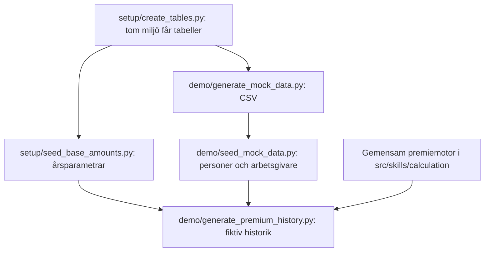

# Kodbas och skriptkatalog

## En kodbas, flera ingångar

Bolagets återanvändbara Pythonkod finns i `src/`. Körverktygen i `scripts/` anropar
denna kod eller förbereder miljö och fiktiva startdata. `tests/` verifierar beteendet.
Det finns ingen separat kodbas per delprojekt eller avdelning (B-015/B-024).

| Område i src | Ansvar |
|---|---|
| models | Databasstruktur: personer, arbetsgivare, försäkringar, lägen, premier, löneunderlag och journaler |
| services | Affärsoperationer, in-/utdata, åtkomst, produktregelkontroll, godkännanden och händelser |
| skills/calculation | Ren ITP1-premieberäkning, återanvänd av operationer och analyser |
| ai | Modellroller, leverantörsadaptrar, strukturerade svar, nycklar och anropslogg |
| analytics | Rena beståndsberäkningar: IBB-scenariot, adapter för offline-backup och konsekvensen av en ändrad produktparameter med undertryckning (`parameter_impact.py`, används av `estimate_parameter_change_impact`, 3c-B) |
| design | Digital klarhets tokenfil (B-034), webbens CSS-variabler som härleds ur den (`web_css.py`) och märket som ikon (`icon.py`) |
| reporting | [Återanvändbar rapportmall i Digital klarhet](../06_design/rapportmall.md), [presentationsmall i 16:9](../06_design/presentationsmall.md) och syntetiska exempel: PDF från Markdown och diagram. Ingen aktiverad skill |
| utils | Databasanslutning, backup/återställning, återanvändbar migrationskod och demobeståndet för handläggar-UI:t, med den äldre kohorten födda 1959–1962 (B-035 val K) |
| web | Handläggar-UI:t (Fas 4): FastAPI-sidor som bara anropar tjänstelagret, och flödena `/floden` genom flödesadaptern, se [handläggar-ui.md](handläggar-ui.md) |
| agents | Harness: körpolicy, skill-register, dispatcher, agentloop, körjournal, ärendekörningar, gatewayerna `regelverk` och `dokument` (`agents/gateways/`, 3c-G), teamen compliance och aktuarie med parametermandat, resultatscheman (`results.py`) och uppdragsmallar (`assignments.py`, 3c-T), flödesmotorn (`agents/flows/`, 3c-2), och flödet `rule_change_parameter` med adaptern för UI:t (`agents/flows/definitions/`, `console.py`, 3c-3). Adaptern kräver uttrycklig AI-klient; det tidigare skriptade demosvaret är borttaget enligt B-037 |
| testing | Testkatalog, ändringsstyrt urval och pytest-markörer; se [teststrategin](teststrategi.md) |
| övriga skill-mappar | Förberedd struktur; ytterligare förmågor byggs enligt fasplanen |

## Var finns körverktygen?

Kör exemplen från repots rot med projektets Pythonmiljö. Alla nedanstående skript
stöder `--help`, som visar användning utan databasanslutning eller AI-anrop.

| Kategori | Skript | Syfte | Sidoeffekt/beroende |
|---|---|---|---|
| testing | [run_tests.py](../scripts/testing/run_tests.py) | Visa grupper eller välj tester efter område/Git-ändringar och beroenden | Planering som standard; `--run` kör lokala tester. `--postgres` tillåter isolerade databasprov enligt AGENTS §4.5. Otestade målområden markeras; se [teststrategin](teststrategi.md) |
| setup | [create_tables.py](../scripts/setup/create_tables.py) | Skapa tabeller som saknas | Skriver schema; uppgraderar inte befintliga tabeller |
| setup | [grant_agent_role.py](../scripts/setup/grant_agent_role.py) | Ge ett agentteams databasroll exakt sina rättigheter (`harness.md` §5.1) | Torrkörning som standard (förkontroll, nuvarande rättigheter, SQL); `--apply` ändrar rättigheter – samordna enligt AGENTS.md §4.5. `--team forsakring` (standard), `aktuarie` eller `compliance`. Rollen skapas av operatören |
| setup | [seed_base_amounts.py](../scripts/setup/seed_base_amounts.py) | Lägg in/uppdatera IBB 2023–2026 | Skriver årsparametrar; tabellen måste finnas |
| demo | [generate_mock_data.py](../scripts/demo/generate_mock_data.py) | Skapa fiktiva personer och arbetsgivare, med den äldre kohorten födda 1959–1962 (B-035 val K) | Skriver CSV, standardmål `data/`; ingen databas. `--older-cohort-only` skriver bara kohorten till `insured_persons_older_cohort.csv`, kopplad till en befintlig `employers.csv` och med stabila id; `--no-older-cohort` utan den |
| demo | [seed_mock_data.py](../scripts/demo/seed_mock_data.py) | Läs CSV till Lakebase | Skriver personer/arbetsgivare; `--reset` tar bort tabeller/data; `--dry-run` läser bara CSV |
| demo | [generate_premium_history.py](../scripts/demo/generate_premium_history.py) | Skapa fiktiva försäkringar och premiehistorik | Skriver databas; kräver personer och IBB. `--dry-run` läser databasen men skriver inte |
| maintenance | [backup_database.py](../scripts/maintenance/backup_database.py) | Spara faktisk databasstruktur och data | Läser databas och skriver backupfiler |
| maintenance | [restore_database.py](../scripts/maintenance/restore_database.py) | Återställ backup | Skapar schema och skriver data; mål ska vara tomt enligt återställningskontrollerna |
| migrations | [migrate_t3_schema.py](../scripts/migrations/migrate_t3_schema.py) | Uppgradera till T3-schema | Skriver schema; kräver backup vid skarp körning. `--dry-run` ansluter och läser |
| migrations | [migrate_cases.py](../scripts/migrations/migrate_cases.py) | Skapa tabellen `cases` (Fas 5, B-033) | Torrkörning som standard; `--apply` kräver `--backup`. Skapar bara `cases`, inga andra tabeller. Samordna enligt AGENTS.md §4.5 |
| migrations | [migrate_product_parameters.py](../scripts/migrations/migrate_product_parameters.py) | Skapa `product_parameters` med startvärden (Fas 3c, B-035) | Torrkörning som standard, även den räknar om alla premier i en transaktion som rullas tillbaka; `--apply` kräver `--backup`. Avvikande premie rullar tillbaka allt. Kör `grant_agent_role.py --apply` efteråt. Samordna enligt AGENTS.md §4.5 |
| migrations | [migrate_flows.py](../scripts/migrations/migrate_flows.py) | Skapa flödesmotorns tabeller `flows`, `flow_steps` och `flow_gate_decisions` (Fas 3c, B-035) | Torrkörning som standard; `--apply` kräver `--backup`. Skapar bara de tre tabellerna; stoppar om bara en del finns. Samordna enligt AGENTS.md §4.5 |
| migrations/legacy | [rebuild_insurance_tables.py](../scripts/migrations/legacy/rebuild_insurance_tables.py) | Historisk ombyggnad för B-022 | Tar bort tabeller/data; inte dagens uppgraderingsväg |
| diagnostics | [test_db_connection.py](../scripts/diagnostics/test_db_connection.py) | Verifiera anslutning med SELECT 1 | Läser databasen; namnet betyder manuell diagnos, inte pytest-test |
| diagnostics | [smoke_test_ai.py](../scripts/diagnostics/smoke_test_ai.py) | Prova leverantörer, strukturerade svar och verktygsloop | Riktiga API-anrop, kostnad och anropslogg |
| diagnostics | [smoke_test_agent.py](../scripts/diagnostics/smoke_test_agent.py) | Kör handläggaragenten genom hela harness mot demobeståndet i minnet (bara läsning och beräkning) | Utan `--run` inga anrop; med `--run` riktiga API-anrop (tak 0,10 USD per leverantör), körjournal i `logs/agent_runs/`. Ingen Lakebase |
| diagnostics | [smoke_test_delegation.py](../scripts/diagnostics/smoke_test_delegation.py) | Röktest av delegering compliance → aktuarie med riktiga modeller (3c-1, B-039) | Utan `--run` inga anrop; med `--run` billigaste modellen per leverantör för rollen deep, `--deep` de konfigurerade. Demobeståndet i minnet med simulerade teamroller; compliance högst 1,00 USD inom körpolicyns rotbudget. Ingen Lakebase |
| diagnostics | [smoke_test_flow.py](../scripts/diagnostics/smoke_test_flow.py) | Röktest av parameterändringsflödet med riktiga modeller för compliance och aktuarie (3c-V) | Utan `--run` inga anrop; med `--run` riktiga API-anrop inom teamens kostnadstak. `--db demo` (SQLite i minnet) eller `svc_test` (eget schema, tas bort efteråt; teamen med begränsade testroller). `--avvikelser` tolkar två testkällor ur `tests/data/regelverk_avvikelser/`. Ingen Lakebase |
| diagnostics | [smoke_test_question.py](../scripts/diagnostics/smoke_test_question.py) | Röktest av bolagsfrågan (`company_question`) från beställning till granskad leverans med riktig modell för aktuarien (OC-3a, B-041) | Utan `--run` inga anrop; med `--run` riktiga API-anrop, högst 1,00 USD per fråga. Samma `--db demo`/`svc_test` som `smoke_test_flow.py`; `--avvikelser` lägger till fråga utanför stödet och styrningsprov. Läsbarhetskontroll: inga tekniska namn i slutsatsen. `reporting.render_report` med DM Sans ur `--report-font-dir`, annars mallens Helvetica-alternativ. Leveranser i `logs/deliveries/rooktest_<tid>/`. Ingen Lakebase |
| diagnostics | [smoke_test_product_report.py](../scripts/diagnostics/smoke_test_product_report.py) | Röktest av produktrapporten (`product_report`) från beställning till granskad leverans med riktig modell för aktuarien (A2, B-042) | Utan `--run` inga anrop; med `--run` riktiga API-anrop, högst 1,00 USD per rapport. Samma `--db demo`/`svc_test` som `smoke_test_flow.py`; `--avvikelser` lägger till ett styrningsprov med påhittat FTA-belopp. Facit: rapportens tabeller mot operationernas egna svar. Leveranser i `logs/deliveries/rooktest_produkt_<tid>/`. Ingen Lakebase |
| analysis | [analyze_premium_impact.py](../scripts/analysis/analyze_premium_impact.py) | Jämför premieeffekt av hypotetiskt IBB | Ren beräkning på demo eller offline-backup; stdout eller rapportfil |
| documentation | [list_operations.py](../scripts/documentation/list_operations.py) | Generera operationsförteckning med behörigheter | Skriver Markdown; `--check` jämför utan att skriva. Ingen databas eller AI |
| documentation | [list_skills.py](../scripts/documentation/list_skills.py) | Uppdatera körpolicyns skills i skillkatalogen | Skriver tabellen i `03_skills/skillkatalog.md`; `--check` jämför utan att skriva. Ingen databas eller AI |
| documentation | [show_agent_profile.py](../scripts/documentation/show_agent_profile.py) | Visa en agents effektiva verktyg enligt `src/agents/ecosystem.yaml`, med skäl för dolda | Skriver till stdout; `--date` prövar regelstatus mot ett datum. Ingen databas eller AI |
| documentation | [build_agent_usage_example.py](../scripts/documentation/build_agent_usage_example.py) | Bygg den fiktiva rapporten om agentnyttjande i Digital klarhet | Läser enbart exempel-JSON, Markdown och designvärden; skriver PDF, Markdown och SVG i `output/pdf/` samt lokal kontroll i `tmp/pdfs/`. Kräver `reportlab` och lokala DM Sans-TTF-filer; se [exemplet](../06_design/exempel/README.md). Ingen databas eller AI |
| documentation | [build_presentation.py](../scripts/documentation/build_presentation.py) | Generera 16:9-presentation med fem bildtyper i Digital klarhet | Läser Markdown och gemensamma designvärden; skriver lokal PDF. Återanvänder rapportens font- och diagramhantering; lokala DM Sans-TTF-filer eller uttrycklig `--helvetica`. Se [presentationsmallen](../06_design/presentationsmall.md). Ingen databas, AI eller gateway |
| web | [build_design_tokens.py](../scripts/web/build_design_tokens.py) | Generera handläggar-UI:ts CSS-variabler ur Digital klarhets tokenfil | Skriver `src/web/static/tokens.css`; `--check` jämför utan att skriva. Ingen databas eller AI |
| web | [install_desktop_shortcut.py](../scripts/web/install_desktop_shortcut.py) | Installera vanlig Lakebase-genväg och separat DEMO-genväg med märket som ikon (Windows) | Uppdaterar genvägarna på skrivbordet och ikonen i `%LOCALAPPDATA%\Artificiellalecta\`; `--db` installerar bara valt läge, `--port` kräver `--db`, `--dry-run` visar bara. Ingen databas eller AI |
| web | [open_ui.ps1](../scripts/web/open_ui.ps1) | Starta och öppna handläggar-UI:t med verifierat databasläge | Startar `start_ui.py` dolt; standard Lakebase på 8765, test på 8766, demo på 8767. Fel eller okänt läge på en upptagen port blockeras; stoppar inga processer |
| web | [set_operator_password.py](../scripts/web/set_operator_password.py) | Operatören sätter själv en lokal lösenfras för bolagsfrågor (OC-3a H–I) | Dold interaktiv inmatning; skriver operatörs-id och Argon2id-hash till `.env`, bevarar övrig konfiguration. Ingen databas, AI eller utskrift av lösenfras/hash; se [operatörsinloggning](operator_inloggning.md) |
| web | [start_ui.py](../scripts/web/start_ui.py) | Starta handläggar-UI:t på 127.0.0.1 | `--db demo` (standard) skapar en lokal SQLite med demobestånd; `--db svc_test` ett eget schema i den isolerade testdatabasen; `--db lakebase` läser och skriver beståndet via tjänstelagret |

## Typiska arbetsflöden

### Förbereda en ny demomiljö



Detta är startdata, inte en process för löpande premiehantering. Generatorn använder en
förenklad antagen lönehistorik och ett bestämt historikfönster. Ordinarie handläggning
går genom tjänstelagret, exempelvis `register_salary_report`; den genererar inte premiehistorik.
Setup-/demo-/underhållsverktygen har direkt databasåtkomst för sina avgränsade uppgifter
och är inte fria agentverktyg. Körningar mot delad Lakebase koordineras enligt AGENTS §4.5.

### Uppgradera, återställa eller analysera

- **Uppgradering av befintligt schema:** backup → migrationskontroll/dry-run → migration.
  Följ ordningen i [databasschema.md](databasschema.md); `create_tables` ersätter inte migrationer.
- **Återställning:** välj backup och tom målmiljö → `maintenance/restore_database.py`.
  Återställning använder backupens schema och data; kör inte demo-seed som ersättning för journaler.
- **Analys:** offline-backup → `analysis/analyze_premium_impact.py` → rapport. Ingen ändring i beståndet.
- **Operationsförteckning:** ändrad operation/regel/åtkomst → `documentation/list_operations.py` → `--check`/tester.

```powershell
python scripts/documentation/list_operations.py --check
python scripts/analysis/analyze_premium_impact.py --scenario-ibb 85000
python scripts/demo/seed_mock_data.py --dry-run
python scripts/migrations/migrate_t3_schema.py --help
```

## Namn och historiska hänvisningar

`seed_supabase.py` heter nu `scripts/demo/seed_mock_data.py`: databasen är Lakebase.
Övriga skript har behållit filnamnet men flyttats från `scripts/` till kategorin i tabellen.
Äldre beslutsloggsposter beskriver sökvägarna vid beslutstillfället och skrivs inte om.

`scripts/smoke_test_ai.py` finns kvar som en liten kompatibilitetsingång till
`scripts/diagnostics/smoke_test_ai.py`, eftersom separata demoanteckningar hänvisar till den.
Den innehåller ingen egen AI-logik. Nya instruktioner använder kategorisökvägen.
Gamla schemalagda kommandon och instruktioner utanför repot behöver uppdateras separat.

## När ett nytt verktyg läggs till

Placera det efter användning, inte efter vilken agent som skrev det. Återanvändbar logik
hör hemma i `src/`; håll kommandoradsingången liten. Uppdatera katalogen med syfte,
beroenden och vad kommandot läser/skriver. Vanliga affärsoperationer använder tjänstelagret.
Tester hör hemma i `tests/`. Det historiska migrationsskriptet är uttryckligen märkt legacy.

Sökvägar till repo, `src/`, `.env`, data och backup ska fortsätta fungera när verktyget körs
från sin kategorimapp. Katalogens körordning och dokumentlänkar ska kontrolleras vid flytt.
