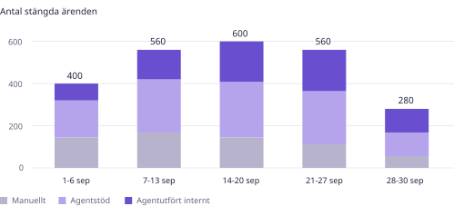
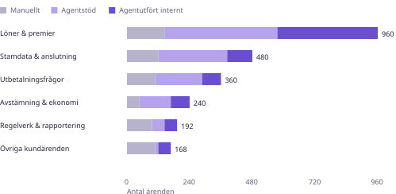
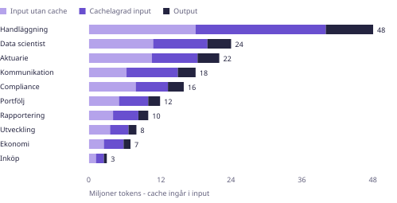
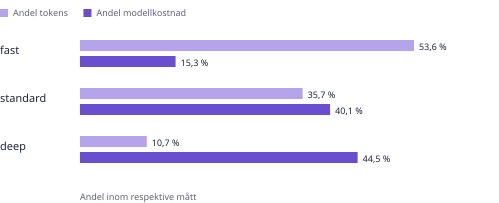
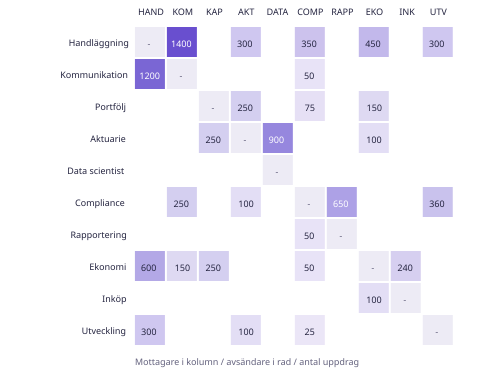
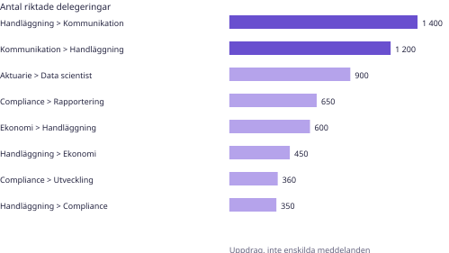
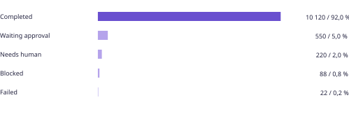
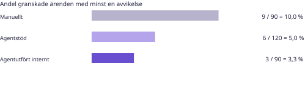
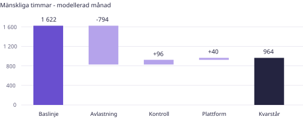
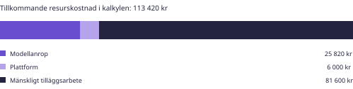

<!-- page: cover | EXEMPELRAPPORT | Agentnyttjande -->
# När agenterna blir en del av arbetet.

Ledningsrapport om användning, kostnad, kvalitet och samverkan.

**Simulerad rapportmånad: september 2026. Upprättad 24 oktober 2026.**

Helt påhittade data för ett tänkt moget driftläge i Artificiellalecta. Rapporten visar hur en framtida uppföljning kan se ut. Den beskriver varken verklig septemberdrift eller vilka funktioner som är byggda i dag.

Design: Digital klarhet v1.0 / B-034. Rapportversion: 1.0.

<!-- page: executive | 01 / LEDNINGENS ÖVERBLICK | Hög användning. Lägre autonomi. -->
<!-- kpis: executive -->

## Slutsats
Agenter berör 74 % av månadens 2 400 stängda ärenden, men endast 30 % avslutas som agentutförda interna flöden. Den avgörande skillnaden är hur mycket mänsklig handläggning som återstår, inte hur ofta en modell anropas.

Den modellerade bruttotidsvinsten är 794 timmar. Efter 136 timmar för tillkommande kontroll och plattformsarbete återstår 658 timmar i kapacitetspotential. Samtidigt kräver scenariot fortfarande 963,6 mänskliga timmar. Visionen om enpersonsdrift är därför inte uppnådd vid denna volym.

## Tre saker att agera på
- **Flytta fokus från täckning till avslut.** Öka andelen väl avgränsade interna flöden som kan slutföras av agenter. Bevara godkännande av externa handlingar.
- **Granska överlämningarna.** Handläggning och kommunikation står tillsammans för 28,9 % av alla delegerade uppdrag. Undersök hur ofta samma underlag måste förklaras igen.
- **Styr efter uppgiftens svårighet.** Rollen deep använder 10,7 % av tokens men står för 44,5 % av modellkostnaden. Prova enklare modellroller där samma kvalitet kan visas.

## Tolkning
Samtliga observationer, jämförelser och slutsatser gäller exempeldata. Tidsvinsterna är modellerade, kvalitetsurvalet är litet och modellpriserna är konstruerade. Ingen effekt är verifierad i verklig drift.

<!-- page: cases | 02 / OPERATIV ANVÄNDNING | Vad görs med agenter - och utan? -->

| Arbetssätt | Ärenden | Andel | Förändring mot aug. |
| --- | --- | --- | --- |
| Manuellt | 624 | 26 % | -9 procentenheter |
| Agentstöd | 1 056 | 44 % | -1 procentenhet |
| Agentutfört internt | 720 | 30 % | +10 procentenheter |
| Totalt | 2 400 | 100 % | +200 ärenden |

## Analys
Agentberöringen stiger från 64 procent i den första delperioden till 80 procent i de två sista. Förskjutningen är tydlig, men delperioderna har olika längd. Staplarna visar därför totalvolym, inte produktivitet per arbetsdag.

Jämfört med det fiktiva augustiscenariot ökar agentberöringen från 65 till 74 procent, samtidigt som totalvolymen ökar från 2 200 till 2 400 ärenden. Agentutförda interna flöden ökar från 20 till 30 procent. Ändrad ärendemix och bemanning kan bidra; utvecklingen visar inte i sig en kausal AI-effekt.

**Definition:** Agentstöd innebär att en människa fortfarande driver huvuddelen av handläggningen. Agentutförda interna flöden saknar rutinmässig manuell ärendehantering, men belastas med viss tillsynstid. Externa handlingar får inte utföras utan föreskrivet godkännande.

<!-- page: processes | 03 / PROCESSER | Automationen är ojämnt fördelad. -->

| Process | Totalt | Agentberört | Agentutfört internt |
| --- | --- | --- | --- |
| Löner & premier | 960 | 85 % | 40 % |
| Stamdata & anslutning | 480 | 75 % | 20 % |
| Utbetalningsfrågor | 360 | 70 % | 20 % |
| Avstämning & ekonomi | 240 | 80 % | 30 % |
| Regelverk & rapportering | 192 | 50 % | 25 % |
| Övriga kundärenden | 168 | 36 % | 29 % |

## Analys
Löner och premier är den största processen och har 85 procents agentberöring. Regelverk och rapportering har bara 50 procents beröring, men varje avlastad handläggning kan vara tidsmässigt betydelsefull. Enbart antal ärenden skulle undervärdera det arbetet.

Övriga kundärenden har låg agentberöring och varierande innehåll. Prioritera återkommande delmoment och tydliga överlämningar innan bred automatisering. Procentsatserna mäter användning i scenariot, inte hur stor andel av alla uppgifter som säkert kan automatiseras.

<!-- page: tokens | 04 / TOKENANVÄNDNING | Tre agenter står för mer än halva volymen. -->

## Analys
Handläggaragenten använder 48 miljoner tokens, motsvarande 28,6 procent av totalen. Handläggning, Data scientist och Aktuarie står tillsammans för 56,0 %. Fördjupa därför arbetet med kontextstorlek, verktygssvar och återanvändbara underlag hos dessa tre.

Totalen 168 miljoner tokens består av 140 miljoner input och 28 miljoner output. Av inputvolymen är 70 miljoner cachelagrade. Cachelagrad input ingår redan i input och får inte adderas en gång till. Cacheandelen är 50 procent av input, inte av total tokenvolym.

| Avgränsning | Tokens | Modellkostnad |
| --- | --- | --- |
| Ärendehänfört | 142,8 miljoner | 21 947 kr |
| Fristående uppdrag | 25,2 miljoner | 3 873 kr |
| Per agentberört ärende | 80,4 tusen | 12,36 kr |

**Avgränsning:** 85 procent av tokens och kostnad är ärendehänförda, 15 procent avser fristående uppdrag. Fördelningen är samma inom varje modellroll. Diagrammet visar all användning; måttet per ärende utesluter fristående uppdrag.

<!-- page: agents | 05 / AGENTÖVERSIKT | Volym och kostnad berättar olika historier. -->
| Agent | Tokens, M | Cache, M | Körningar | Modellanrop | Kostnad, kr |
| --- | --- | --- | --- | --- | --- |
| Handläggning | 48,0 | 22,0 | 3 600 | 12 000 | 3 656 |
| Kommunikation | 18,0 | 8,7 | 1 800 | 6 000 | 1 049 |
| Portfölj | 12,0 | 4,9 | 600 | 1 600 | 1 766 |
| Aktuarie | 22,0 | 7,7 | 800 | 2 600 | 5 615 |
| Data scientist | 24,0 | 9,2 | 900 | 3 200 | 4 513 |
| Compliance | 16,0 | 5,4 | 700 | 2 000 | 5 640 |
| Rapportering | 10,0 | 4,3 | 650 | 1 800 | 1 421 |
| Ekonomi | 7,0 | 3,3 | 900 | 2 000 | 437 |
| Inköp | 3,0 | 1,3 | 240 | 700 | 261 |
| Utveckling | 8,0 | 3,1 | 810 | 1 800 | 1 462 |
| Totalt | 168,0 | 70,0 | 11 000 | 33 700 | 25 820 |

## Analys
Compliance och Aktuarie står tillsammans för 43,6 % av modellkostnaden. Det beror främst på att de använder deep-rollen oftare, inte på att de har flest körningar. Handläggning är störst i tokens men har en betydligt billigare rollmix.

En körning är ett agentsegment med eget run_id. En rotkörning kan delegera till flera nya körningar. Månadens 11 000 körningar kommer från 2 000 rotkörningar och 9 000 delegerade körningar. Antalet körningar är därför varken antalet ärenden eller antalet unika användaruppdrag.

## Rekommenderad uppföljning
Jämför varje agent med dess egna uppgifter och svårighetsgrad över tid. Följ kostnad per accepterat resultat och andel utfall som kräver omarbete. En enkel rangordning efter kronor eller tokens missgynnar specialistuppdrag och kan uppmuntra sämre kvalitet.

**Läs tabellen:** Cache avser cachelagrad input. Kostnad är beräknad med rapportens fiktiva rollpriser. Avrundade radbelopp kan avvika från summerad total; totalen beräknas före avrundning.

<!-- page: costs | 06 / MODELLROLLER | Deep driver kostnaden, inte volymen. -->

| Modellroll | Input utan cache | Cachelagrad input | Output |
| --- | --- | --- | --- |
| fast | 40 | 8 | 160 |
| standard | 140 | 28 | 560 |
| deep | 500 | 100 | 2 000 |

## Analys
Deep svarar för 10,7 % av tokenvolymen men 44,5 % av modellkostnaden. Att korta ett deep-anrop kan därför vara mer ekonomiskt relevant än att ta bort flera korta fast-anrop. Modellvalet ska dock följa uppgift och verifierad kvalitet.

| Modellroll | Tokens, M | Kostnad, kr | Kostnadsandel |
| --- | --- | --- | --- |
| fast | 90,0 | 3 960 | 15,3 % |
| standard | 60,0 | 10 360 | 40,1 % |
| deep | 18,0 | 11 500 | 44,5 % |

**Prisgrund:** Alla priser ovan är uttryckligen påhittade SEK per miljon tokens, utan moms. De är inte aktuella priser från OpenAI, Anthropic eller någon annan leverantör. Kostnaden är okachelagrad input gånger dess pris, plus cachelagrad input gånger cachepriset, plus output gånger outputpriset. Inget separat debiterat cache-skrivpåslag ingår i modellen.

<!-- page: network | 07 / AGENTSAMVERKAN | Vem beställer arbete av vem? -->

## Så läses bilden
Raden är avsändande agent och kolumnen mottagare. Talen är nya delegerade uppdrag som startat en barnkörning. Ett vanligt svar i samma konversation räknas inte som ett nytt uppdrag. Nollor lämnas tomma och diagonalen används inte för självanrop.

Totalt finns 9 000 delegeringar. 7 060 går mellan team och 1 940 inom team. Uppdrag till specialister passerar deras teamledare när de kommer från ett annat team, i linje med målarkitekturen. Matrisen är en fiktiv målbild, inte en export från dagens harness.

**Förkortningar:** HAND handläggning; KOM kommunikation; KAP portfölj; AKT aktuarie; DATA Data scientist; COMP compliance; RAPP rapportering; EKO ekonomi; INK inköp; UTV utveckling.

<!-- page: handoffs | 08 / ÖVERLÄMNINGAR | Den största relationen går åt båda håll. -->

## Analys
Handläggning skickar 1 400 uppdrag till Kommunikation och får 1 200 nya uppdrag tillbaka. Tillsammans motsvarar relationen 2 600 uppdrag, eller 28,9 % av all delegering. Det kan vara en legitim uppdelning av ärendelogik och kanalansvar, men också ett tecken på upprepade kompletteringar.

Volymen ensam visar inte att ett samarbete är ineffektivt. Följ därför andel kompletta beställningar, antal kompletteringsvarv och ledtid från första beställning till godkänt underlag. Svarstexter ska inte misstas för nya delegeringar i mätningen.

## Förbättring att pröva
Inför ett gemensamt uppdragskontrakt med ärendereferens, mottagare, syfte, källor, beslut och förväntat format. Återanvänd underlag via behörighetsstyrda referenser. Att kopiera hela historiken mellan team ökar både kontextkostnad och risken för felaktig spridning av uppgifter.

<!-- page: reliability | 09 / DRIFT OCH KONTROLL | Ett stopp kan vara ett korrekt resultat. -->

| Unika förslag | Antal | Andel av 820 |
| --- | --- | --- |
| Godkända | 686 | 83,7 % |
| Avslagna | 62 | 7,6 % |
| Återtagna | 32 | 3,9 % |
| Öppna vid periodslut | 40 | 4,9 % |

## Analys
92 procent av körsegmenten slutar som completed. Ytterligare 5 procent väntar på godkännande. Det är ett kontrollerat stopp, inte ett tekniskt fel. Av 11 000 segment slutar 88 som blocked och 22 som failed. Orsakerna måste följas separat; en väl fungerande spärr kan höja säkerheten även om den sänker den råa slutförandeandelen.

820 unika förslag har skapats. 780 är avgjorda och 40 öppna i scenariots periodstängning. 550 väntande körsegment är ett annat mått: ett segment kan skapa flera förslag. Bland avgjorda förslag är medianväntan 42 minuter och p95 210 minuter, båda konstruerade exempelvärden.

**Omtag:** 2 022 av 33 700 modellanrop är omtag, motsvarande 6,0 %. De står för antagna 8 procent av tokens och kostnad, redan inkluderade i månadstotalen. Följ både första-gången-rätt och slutligt utfall; extra försök kan dölja en instabil verktygsintegration.

<!-- page: quality | 10 / KVALITET OCH SERVICE | Snabbare flöden måste också bli rätt. -->

| Ärendekohort | Median, tim | P95, tim | SLA-brott | Andel |
| --- | --- | --- | --- | --- |
| Manuellt | 14,2 | 54,0 | 75 | 12,0 % |
| Agentstöd | 5,8 | 24,0 | 63 | 6,0 % |
| Agentutfört internt | 0,6 | 4,2 | 14 | 1,9 % |

## Analys
I ett stratifierat stickprov med 300 granskade ärenden finns 18 avvikelser: 4 större och 14 mindre, inga kritiska. De lägre felfrekvenserna i agentgrupperna kan bero på enklare ärenden och andra urvalsregler. Utan jämförbar svårighetsgrad och större urval kan ingen kausal kvalitetseffekt dras.

SLA i scenariot är 16 arbetstimmar från mottagning till stängning. 152 av 2 400 ärenden överskrider gränsen. Median och p95 är konstruerade för respektive kohort; ett totalt p95 kan inte beräknas genom att väga ihop dessa tre p95-värden.

## Föreslagen kvalitetsgrind
Innan automatandelen höjs: granska regelriktighet, källstöd, motivering, spårbarhet och behov av omarbete. Behåll obligatoriska godkännanden även när en agent presterar väl i stickprovet. Tid till stängning och aktiv mänsklig arbetstid är olika mått.

<!-- page: capacity | 11 / MÄNSKLIG KAPACITET | Avlastning räcker inte hela vägen. -->

| Mänskligt arbete | Timmar | Mätgrund |
| --- | --- | --- |
| Manuell baslinje | 1 621,6 | Samma processmix, antagna tider |
| Direkt handläggning med agenter | 827,6 | Antagna tider per arbetssätt |
| Tillkommande centrala aktiviteter | 136 | 96 timmar kontroll + 40 drift |
| Total belastning | 963,6 | Direkt arbete + centrala aktiviteter |
| Nettopotential | 658 | Baslinje minus total belastning |

## Analys
Direkt handläggning minskar från 1 621,6 till 827,6 timmar i tidsmodellen. Tillkommande granskning, mandatförvaltning och avvikelsearbete antas kräva 96 timmar, plattformsdrift 40 timmar. Den totala mänskliga belastningen blir 963,6 timmar.

Scenariot antar en tillgänglig mänsklig kapacitet om 800 timmar, ungefär fem heltidsmånader om 160 timmar. Belastningen ligger 163,6 timmar över denna nivå. Det är långt från visionens enpersonsram om 160 timmar, även om arbetet kan vara fördelat på anställda, operatör eller externa resurser.

**Begränsning:** Alla tider är antaganden. Baslinjen har samma processmix men ingen justering för svårighetsgrad inom processen. Tillsyn per ärende ingår i direkt arbete; de 136 timmarna avser separata centrala aktiviteter. Frigjord tid är kapacitetspotential, inte realiserad personal- eller kassabesparing.

<!-- page: economics | 12 / EKONOMI | Modellnotan är bara en del av kalkylen. -->
| Illustrativ kalkylpost | Belopp, kr | Tolkning |
| --- | --- | --- |
| Bruttotidens kapacitetsvärde | 476 400 | 794 timmar x 600 kr |
| Tillkommande mänskligt arbete | -81 600 | 136 timmar x 600 kr |
| Modellkostnad | -25 820 | Fiktiva rollpriser |
| Plattform | -6 000 | Antaget tillkommande månadsbelopp |
| Teoretisk nettopotential | 362 980 | Inte realiserad kassabesparing |

## Analys
Den direkta modellkostnaden är 25 820 kronor. Tillkommande kontroll- och plattformsarbete värderas till 81 600 kronor med rapportens antagna 600 kronor per timme. I detta scenario är alltså människans arbete en större post än själva modellnotan.

Den teoretiska nettopotentialen är 362 980 kronor efter värdering av nettotiden och avdrag för modell och plattform. Detta är en räkneövning, inte redovisad vinst eller realiserad kassabesparing. Befintlig handläggningslön, införandeinvestering, utbildning, förändringsarbete och eventuell kvalitetsförlust ingår inte som fullständiga kostnadsposter.

**Enhetskostnad:** Ärendehänförd modellkostnad är 21 947 kronor för 1 776 agentberörda ärenden, alltså 12,36 kronor per sådant ärende. De fristående uppdragens kostnad har uteslutits ur täljaren. Hela programkostnaden ska inte utan vidare divideras med ett enda teams ärendevolym.

<!-- page: optimization | 13 / FÖRBÄTTRINGSSCENARIER | Små förändringar kan testas kontrollerat. -->
| Fristående alternativ | Antagande | Potential, kr/mån |
| --- | --- | --- |
| Högre cacheandel | 50 till 65 % av input | 2 496 (9,7 %) |
| Mindre deep | 25 % av deep till standard | 2 098 (8,1 %) |
| Färre omtag | Halvera omtagens volym och kostnad | 1 033 (4,0 %) |

## Ett verksamhetsscenario
Flytta 360 ärenden från agentstöd till agentutförda interna flöden: 240 inom löner och premier, 72 inom stamdata samt 48 inom avstämning. Med antagna handläggningstider frigör det ytterligare 55,2 timmar. Agentberöringen ligger kvar på 74 procent, medan automatandelen stiger från 30 till 45 procent.

Det illustrerar varför täckning kan stå still samtidigt som nyttan ökar. Efter förändringen skulle scenariots mänskliga belastning fortfarande vara 908,4 timmar, om centralt kontrollarbete och plattformsarbete är oförändrade. Mer automatik ensamt löser alltså inte enpersonsvisionen vid denna volym.

## Så ska scenarierna användas
Kostnadsalternativen ovan är fristående beräkningar med samma grunddata. De får inte summeras: cache, omtag och modellbyte kan beröra samma anrop. Ingen kvalitets- eller faktisk kostnadseffekt är verifierad. Pröva först på jämförbara uppgifter med oförändrade behörigheter och godkännandekrav.

<!-- page: actions | 14 / ÅTGÄRDSPLAN | Mät nyttan där arbetet faktiskt förändras. -->
| Horisont | Åtgärd | Ansvar i scenariot | Kontrollmått |
| --- | --- | --- | --- |
| 0-30 dagar | Bind ihop ärende, rotkörning, anrop och beslut | Utveckling + processägare | Täckning och avstämda totalsummor |
| 0-30 dagar | Minska schema- och verktygsfel vid omtag | Utveckling | Omtag per anrop, första-gången-rätt |
| 0-30 dagar | Standardisera beställningar mellan handläggning och kommunikation | Försäkring + Kommunikation | Kompletteringsvarv och ledtid |
| 31-60 dagar | Pröva cache och enklare modellroll på jämförbara uppgifter | Utveckling + fackansvariga | Kostnad per accepterat resultat |
| 31-60 dagar | Pilot för 360 ytterligare interna avslut | Processägare + Compliance | Kvalitet, avlastning och undantag |
| 61-90 dagar | Validera faktiskt tidsutfall och kapacitet | Operatör + Ekonomi | Mätta minuter och kvarvarande belastning |

## Rekommenderad ordning i det fiktiva driftläget
Först behövs sammanhängande mätkedjor från ärende till körning, modell- och verktygsanrop samt mänskligt beslut. Därefter går det att förbättra beställningskvalitet och omtag. Först när jämförbar kvalitet kan visas bör fler flöden eller billigare modellroller provas.

## Ledningens månadsfrågor
- Hur många jämförbara ärenden avslutades med godkänt resultat, och hur mycket mänskligt arbete återstod?
- Vilka agentrelationer skapade mest kompletteringsarbete eller väntan?
- Vilka modellkostnader gav verifierat värde och vilka drevs av omtag eller stor kontext?
- Vilka fel stoppades, vilka passerade kvalitetsgrinden och vilka återkom?

Åtgärdsplanen är ett exempel för det tänkta mogna bolaget. Den innebär inga nya projektbeslut och ersätter inte den faktiska byggordningen i ATT_GORA.md.

<!-- page: method | 15 / METOD OCH AVSTÄMNING | Samma underlag ska gå att följa hela vägen. -->
| Kontroll | Avstämt samband |
| --- | --- |
| Ärenden | 624 + 1 056 + 720 = 2 400 |
| Körningar | 2 000 rotkörningar + 9 000 barnkörningar = 11 000 |
| Mottagna uppdrag | Varje agents körningar = egna rötter + inkommande delegeringar |
| Tokens | 140 M input + 28 M output = 168 M; cache 70 M ingår i input |
| Modellroller | 90 M fast + 60 M standard + 18 M deep = 168 M |
| Modellkostnad | 3 960 + 10 360 + 11 500 = 25 820 kr |
| Granskat urval | 90 + 120 + 90 = 300; 9 + 6 + 3 = 18 avvikelser |
| Kapacitet | 1 621,6 - 794 + 96 + 40 = 963,6 timmar |

## Kohorter och definitioner
Ärendekohorten omfattar månadens stängda ärenden. Körningar, anrop och delegeringar avser månadens startade händelser. Populationerna har ingen generell ett-till-ett-relation. Exemplet har 1 776 ärendehänförda och 224 fristående rotuppdrag, totalt 2 000.

Tokenvolym, kostnad, omtag och ärendetillhörighet är överlappande klassificeringar av samma modellanrop. De får inte läggas ihop. Alla timmar är modellerade; kvalitetsutfall, ledtider och godkännandetider är konstruerade scenariodata.

## Hur verklig mätning kan försörja rapporten
Modellanropsloggen kan ge modellroll, tokenvolym, cache och prisgrund. Körjournalen ger run_id, rot och barn, utfall och budget. Ärenden, operation_events och approval_requests ger ärendekohorter och mänskliga beslut. Delegering och aktiva handläggningsminuter behöver egen, entydig instrumentering innan motsvarande effektmått kan användas i verklig drift.

**Källor:** data/examples/agent_usage_2026_09.json (helt fiktivt). Agentnamn och team följer projektets ekosystem. Formgivning: Digital klarhet v1.0, B-034. Inga företagsloggar, kunduppgifter, fakturor eller verkliga modellpriser har använts.

**Reproducerbarhet:** Generatorn bygger PDF, diagram och Markdown och validerar avstämningarna. Beräkning sker före avrundning. Körinstruktion finns i 06_design/exempel/README.md.
