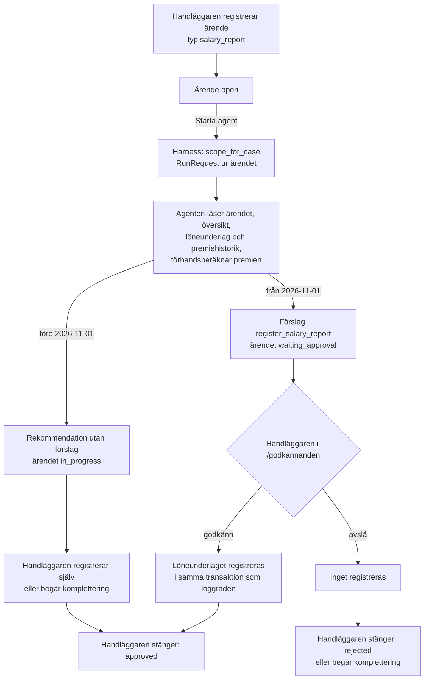

# Beslutsförslag: ärenden (`cases`) och handläggaragentens första flöde (Fas 5)

> **Status:** Godkänt av operatören i chatten 2026-10-24, med valen A–H enligt rekommendationerna i §6, och loggat som **B-033**. Byggs i stegen F5-1–F5-6 (§7).
> **Datum:** 2026-10-24, på `main` `ed56114` (harness 3b-1–3b-8 klar).
> **Underlag:** regelpaketets ingång `01_domän/produktregler/README.md` (utfall och manuella ärenden), PR-ITP1-014 (löneunderlag), -017 (avvikelser och ärenden vid saknad lön), -030 (klagomål och tidsfrister), -031 (data, mänsklig prövning och gallring); `02_system/harness.md` §5.1, §7, §9.1 och §10.1; `02_system/tjänstelager.md` §5; `02_system/databasschema.md`.
> **Bygger på:** B-017, B-020, B-026, B-028, B-030, B-031, B-032.

---

## 1. Varför

Harness är klar: handläggaragenten kan läsa, räkna och föreslå inom ett resursmandat, och körningen journalförs.
Men det finns inget **ärende** att ge agenten. I dag bygger betrodd kod mandatet direkt för en person
(`scope_for_person`), och uppdraget är fri text. Det räcker för röktestet men inte för handläggning:

- Det finns ingen plats för det som kommit in – vem, vad, när, från vem och med vilken referens.
- Ingen status visar om något väntar på agenten, på godkännande, på komplettering eller är klart.
- Utfallet (godkänt, avslaget, komplettering, manuell prövning) sparas ingenstans.
- `case_id` finns redan i tjänstelagrets kontext, i godkännandekön och i händelseloggen, men pekar inte på något.

Ett ärende blir agentens **arbetsenhet och mandat**: agenten får bara röra det ärendet gäller, och allt som görs
knyts till ärendet.

## 2. Förslaget i korthet

1. **Tabellen `cases`** med ärendets typ, status, utfall, berörd försäkrad, försäkring och arbetsgivare, period,
   kanal, mottagningsdag, referens och typens uppgifter. Ärendenummer `CASE-NNNNNN`.
2. **Ärendeoperationer i tjänstelagret.** Handläggaren skapar, tilldelar och stänger. Agenten får bara läsa
   *sitt* ärende.
3. **Resursmandatet byggs ur ärendet** (`scope_for_case`): ärendets person, försäkringar, arbetsgivare och
   period. En körning gäller ett ärende.
4. **Första flödet: nytt löneunderlag**, enligt `harness.md` §7. Handläggaren registrerar ärendet och startar
   agenten från UI:t. Agenten läser, räknar och föreslår registrering. Handläggaren godkänner i kön och stänger
   ärendet.
5. **Handläggar-UI:t** får sidorna `/arenden` (lista och detalj) med knappen *Starta agent* och agentens
   resultat, kostnad och journal.

Schemaändring: ja, en ny tabell (migration enligt T3-mönstret, backup och samordning enligt AGENTS.md §4.5).
Inga befintliga tabeller ändras.

---

## 3. Datamodellen: `cases`

| Kolumn | Typ | Null | Krav och syfte |
|---|---|---|---|
| `id` | `UUID` | Nej | Primärnyckel |
| `case_number` | `VARCHAR(20)` | Nej | Unikt, `CASE-NNNNNN`. Det är detta som står i `case_id` i godkännandekön och händelseloggen |
| `case_type` | `VARCHAR(40)` | Nej | `CHECK` mot tillåtna typer. v1: `salary_report` (se val C) |
| `status` | `VARCHAR(20)` | Nej | `open`, `in_progress`, `waiting_approval`, `waiting_info`, `closed` |
| `outcome` | `VARCHAR(20)` | Ja | `approved`, `rejected`, `supplement_requested`, `manual_review`, `no_action`. Krävs exakt när `status = closed` |
| `insured_person_id` | `UUID` FK | Ja | Den försäkrade ärendet gäller |
| `policy_id` | `UUID` FK | Ja | Försäkringen, om ärendet gäller en viss |
| `employer_id` | `UUID` FK | Ja | Arbetsgivaren, t.ex. avsändare av löneunderlaget |
| `period_month` | `DATE` | Ja | Månaden ärendet gäller, första dagen i månaden |
| `channel` | `VARCHAR(20)` | Nej | `manual` i v1; `employer_file`, `customer_portal` och `chatbot` reserveras (delprojekt 3 och 7) |
| `received_date` | `DATE` | Nej | Mottagningsdag (PR-ITP1-031: mottagningsdatum ska alltid finnas) |
| `source_reference` | `VARCHAR(100)` | Ja | Avsändarens referens, t.ex. lönefilens id |
| `due_date` | `DATE` | Ja | Tidsfrist, t.ex. 14 dagar för klagomål (PR-ITP1-030). Ingen frist för löneunderlag i v1 |
| `details` | `JSONB` | Nej | Typens uppgifter, validerade mot en Pydantic-modell per typ (val F). För `salary_report`: rapporterad lön, källa, `kind`, ev. `corrects_version` |
| `assigned_to` | `VARCHAR(100)` | Ja | Handläggaren som äger ärendet |
| `last_run_id` | `VARCHAR(100)` | Ja | Senaste agentkörningen; journalen i `logs/agent_runs/<run_id>.jsonl` |
| `created_by` | `VARCHAR(100)` | Nej | Den som registrerade ärendet |
| `closed_by`, `closed_at`, `closing_note` | | Ja | Fylls vid stängning; `closing_note` krävs vid `rejected` och `manual_review` |
| `created_at`, `updated_at` | `TIMESTAMPTZ` | Nej | Som övriga tabeller |

**Constraints:** minst en av `insured_person_id` och `employer_id`; `outcome` och `closed_*` satta exakt när
ärendet är stängt; `period_month` är en månadsförsta. Index på `status`, `insured_person_id` och `case_type`.

**Historik.** Varje ändring av ett ärende går via en tjänsteoperation och loggas därmed i `operation_events`
med `case_id`. Där finns alltså vem, när, vad och varför. Ingen separat händelsetabell i v1 (val A).

**Personuppgifter.** `details` kan innehålla lön och fri text. Gallring följer PR-ITP1-031 (årlig
behovsprövning, råbilagor tas bort när ärendet avslutats) och beslutas i tjänstelagerprojektets
lagringspolicy – inte här.

## 4. Operationerna

| Operation | Typ | PII | Register | Effektiv för agenter | Vad den gör |
|---|---|---|---|---|---|
| `create_case` | `write` | Ja | `HUMAN_ONLY` | `HUMAN_ONLY` | Registrerar ärendet med typens uppgifter. Personen, försäkringen och arbetsgivaren måste finnas; för `salary_report` krävs person, arbetsgivare och månad |
| `get_case` | `read` | Ja | `AGENT` | `AGENT`, bara eget ärende | Ärendet med typens uppgifter. Harness nekar andra ärenden än körningens (§5) |
| `list_cases` | `read` | Ja | `HUMAN_ONLY` | `HUMAN_ONLY` | Lista med filter på status, typ och tilldelad, för UI:t |
| `update_case_status` | `write` | Nej | `HUMAN_ONLY` | `HUMAN_ONLY` | Byter status (t.ex. `in_progress`, `waiting_approval`, `waiting_info`) med motivering. Används av handläggaren och av harness som systemaktör efter en körning |
| `close_case` | `write` | Nej | `HUMAN_ONLY` | `HUMAN_ONLY` | Stänger med utfall och anteckning. `approved` kräver att ett kopplat förslag är godkänt eller att handläggaren registrerat själv |

Alla skrivningar saknar produktregel och är därmed `HUMAN_ONLY` för agenter genom golvet (B-028), oavsett
registret. **Agenten kan inte skapa, ändra eller stänga ärenden.** Den kan läsa sitt ärende och föreslå
affärsoperationer som förut, och harness skriver statusen efter körningen som systemaktör.

Avslag, negativa beslut och manuell prövning avgörs alltid av handläggaren (PR-ITP1-031). Utfallen följer
regelpaketets ingång: godkänd, avslagen med regelgrund, komplettering och manuell prövning, plus `no_action`
för ärenden som visar sig inte kräva något.

## 5. Harness: ärendet som mandat

**Resursmandatet ur ärendet.** `scope_for_case(service, case_number)` ersätter `scope_for_person` för
verksamhetskörningar:

- personen, dess försäkringar och arbetsgivaren hämtas ur ärendet och tjänstelagret, inte ur uppdragstexten;
- perioden är ärendets månad och högst 23 månader bakåt (24 månader totalt, `harness.md` §6.3);
- `ExecutionScope.case_id` sätts till ärendenumret, och `RunRequest.case_id` måste stämma.

**`get_case` i resurskontrollen.** I dag skulle ett anrop med bara ärendenummer nekas, eftersom det inte anger
någon försäkrad, och fältet `case_number` prövas inte alls. Resurskontrollen får därför en regel för
`case_number`: värdet måste vara `scope.case_id`, och det räknas som anropets subjekt. Agenten kan bara läsa
ärendet körningen gäller.

**Uppdraget byggs ur ärendet.** En mall per ärendetyp ger mål, begränsningar och förväntat resultat. För
`salary_report`:

> Kontrollera det inrapporterade löneunderlaget i ärendet. Läs ärendet, den försäkrades översikt, tidigare
> löneunderlag och premiehistorik för månaden, och förhandsberäkna premien. Föreslå registrering om underlaget
> är komplett och inte krockar med befintliga uppgifter; annars beskriv vad som saknas. Ingen premierättelse
> och ingen kundkontakt.

Profilen får verktygen `get_case`, `get_insured_overview`, `get_salary_reports`, `get_premium_history`,
`calculate_premium_preview` och `register_salary_report`. Före 2026-11-01 är det sista dolt av regelgolvet, så
agenten kan bara rekommendera. `get_case` läggs i podden `kunddata`.

**Efter körningen** skriver harness som systemaktör: `last_run_id`, och status `waiting_approval` om ett förslag
väntar, annars `in_progress`. Ärendets status ändras aldrig av modellen.

**Databasrollen.** `agent_forsakring` får `SELECT` på `cases` (via `grant_agent_role.py`). Kundscope verkställs
i harness, inte i databasen.

## 6. Val att stämma av

| | Fråga | Rekommendation | Alternativ |
|---|---|---|---|
| A | Ärendets historik | Bara `cases` med aktuell status; historiken i `operation_events` via `case_id` | Egen tabell `case_events` med statusbyten och anteckningar (mer läsbart i UI:t, men en andra logg att hålla i synk) |
| B | Vem skapar ärenden i v1 | Handläggaren i UI:t (`create_case` `HUMAN_ONLY`) | Även agenten, som förslag (`APPROVAL`) · automatisk import från arbetsgivarfil (kräver filformat och kanal, delprojekt 3) |
| C | Ärendetyper i v1 | Bara `salary_report` | Även `general` (fritext, ingen agent) och `complaint` med tidsfristerna i PR-ITP1-030 |
| D | Hur agenten startas | Handläggaren klickar *Starta agent* på ärendet; körningen går synkront i UI:t (lokalt, en användare) | Automatiskt när ett ärende skapas · bakgrundsarbetare med kö (behövs för flera användare och för att avbryta pågående modellanrop, `harness.md` §6.3) |
| E | Avslut | Handläggaren stänger ärendet efter godkännande eller avslag; fortsättningen (3b-5) är en valfri knapp för agentens sammanfattning | Automatisk fortsättning efter beslut som föreslår avslut |
| F | Typens uppgifter | `details` som JSONB, validerat mot en Pydantic-modell per typ | Egna kolumner eller en tabell per typ (starkare databaskontroll, men en schemaändring per ny typ) |
| G | Agentens läsning av ärendet | Ny operation `get_case` (`AGENT`) som bara når körningens ärende | Inget eget verktyg – harness lägger ärendets uppgifter i uppdragstexten (enklare, men uppgifterna blir fri text i stället för strukturerat verktygssvar) |
| H | Agenten i UI:ts demoläge (SQLite) | Tillåten med simulerad databasroll, tydligt märkt i UI:t – som röktestet | Bara mot `svc_test` eller Lakebase med den riktiga rollen `agent_forsakring` |

## 7. Byggsteg efter beslut

| Steg | Innehåll |
|---|---|
| F5-1 | `cases` i `databasschema.md` och `src/models/`, migration `migrate_cases.py` (torrkörning som standard), tester |
| F5-2 | Operationerna i §4 med åtkomstrader och tester; förteckningen genereras om |
| F5-3 | `scope_for_case`, `case_number` i resurskontrollen, uppdragsmall per typ, `get_case` i podden `kunddata`, statusskrivning efter körning; skillkatalogen genereras om |
| F5-4 | UI: `/arenden`, registrering, detalj med *Starta agent*, resultat, kostnad och länk till journalen; koppling till `/godkannanden` |
| F5-5 | Rättigheter för `agent_forsakring` på `cases`; migration och `grant_agent_role.py --apply` mot Lakebase efter backup och operatörens OK (AGENTS.md §4.5); skarp verifiering med en märkt verifieringspost, som S6 |
| F5-6 | Röktest av hela flödet mot riktig modell: ärende → agent → förslag → godkännande → stängt (efter 2026-11-01, när förslaget kan läggas) |

## 8. Utanför v1 (förslag till ATT_GORA)

- Ärendetyperna `complaint` (PR-ITP1-030, med tidsfrister och påminnelser) och `general`.
- Inkommande kanaler: arbetsgivarfil, kundportal (delprojekt 3) och chattbot (delprojekt 7).
- Ärenden som skapas av regler, t.ex. saknad lön eller förfallen premie (PR-ITP1-017).
- Bakgrundsarbetare för agentkörningar, med avbrytbara modellanrop.
- Kommunikationsagentens besked till kund från ett ärende (`external`, kräver godkännande).
- Lagringspolicy och gallring för ärendenas uppgifter (PR-ITP1-031).

## 9. Beslutsförslag (loggat som B-033)

> **Beslut:** Ärenden införs i försäkringssystemet (Fas 5) som tabellen `cases` med typ, status, utfall,
> berörd försäkrad, försäkring och arbetsgivare, period, kanal, mottagningsdag, referens och typens uppgifter
> (`details`, validerade per typ). Ärendenumret `CASE-NNNNNN` är det som står i `case_id` i tjänstelagrets
> kontext, godkännandekö och händelselogg. Tjänstelagret får operationerna `create_case`, `list_cases`,
> `update_case_status` och `close_case` (`HUMAN_ONLY`) samt `get_case` (`AGENT`, bara körningens ärende).
> Ärendet är handläggaragentens arbetsenhet och mandat: resursmandatet byggs ur ärendet (`scope_for_case`),
> en körning gäller ett ärende, och agenten kan inte skapa, ändra eller stänga ärenden. Första ärendetypen är
> `salary_report`: handläggaren registrerar och startar agenten, agenten läser, räknar och föreslår
> registrering, och handläggaren godkänner och stänger. *(Valen A–H enligt operatörens beslut.)*
>
> **Motivering:** Agenten behöver en avgränsad arbetsenhet med strukturerade uppgifter i stället för fri text,
> och handläggningen behöver status och utfall. Mandatet ur ärendet gör kundscopet spårbart till ett registrerat
> underlag. Spåren finns redan (`case_id` i kö och logg), så bara tabellen och operationerna tillkommer.
>
> **Konsekvenser:** Ny tabell och migration, fem operationer med åtkomstrader, `SELECT` på `cases` för
> `agent_forsakring`, `scope_for_case` och uppdragsmallar i harness, sidor för ärenden i handläggar-UI:t.
> `databasschema.md`, `tjänstelager.md`, `harness.md`, `handläggar-ui.md`, skillkatalogen och
> operationsförteckningen uppdateras. Ärendetyperna klagomål och allmänt, inkommande kanaler, regelstyrda
> ärenden och bakgrundsarbetare läggs i ATT_GORA.
>
> **Preciserar:** B-020 (handläggar-UI före kundportal), B-026 (handläggaragenten) och B-028 (tjänstelagret).
