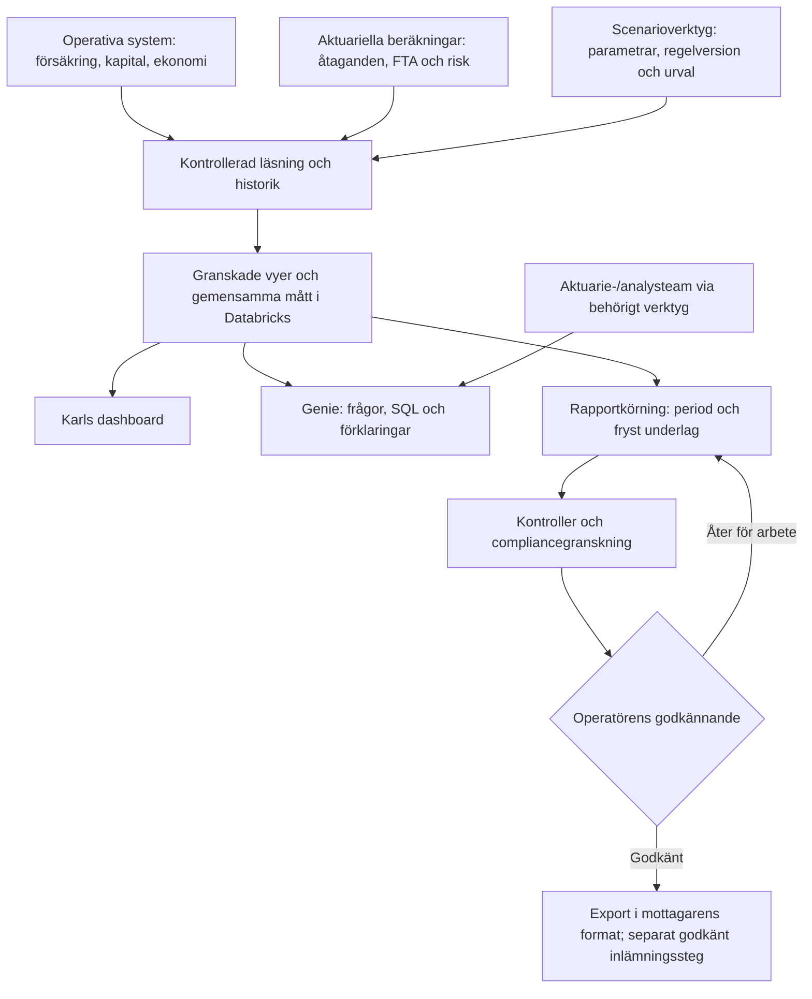

# Dashboard, insikter och rapportering – första designförslag

> 2026-10-11. Arkitekturinriktning beslutad i B-029; konkreta mått och integrationsdetaljer är förslag.
> Inga nya mått eller Databricks-integrationer är driftsatta.
> Utgår från ett simulerat tjänstepensionsbolag med traditionell ITP1 ålderspension.
> Kapital-, aktuariella och regulatoriska beräkningar är beroenden till andra delprojekt.

> **Precisering 2026-10-25:** dashboardens ledningsmått ska försörja
> [projekt 10:s operatörscentral på VD-nivå](../10_operatörscentral/PROJEKTPLAN.md).
> Där visas teamens arbete, agentkostnader och väsentliga inriktningsfrågor.
> Enskilda handläggarärenden och deras godkännanden hanteras i specialistvyer.
> Måttens ägarskap och Databricks-inriktningen enligt B-029 består.

> **OC-0-förslag 2026-10-26:** [Gemensamt måttkontrakt och första katalog](../../02_system/operatörscentral_beslutsforslag.md#3-måttkontrakt--bf)
> föreslås för BI, central och agentsvar. Projekt 2 och domänägaren granskar
> definitionerna före implementation; förslaget aktiverar inga mått eller integrationer.

## Vad operatören ska kunna förstå

Dashboarden ska besvara: hur stort är bolaget, kan vi bära våra pensionslöften, vad ändras
och vad kräver uppmärksamhet? Samma definierade underlag ska kunna användas för Genie-frågor,
agentanalys och rapportering. En regeländring är ett användningsfall, inte hela BI-projektet.

Föreslagna huvudkort: antal försäkrade, förvaltat kapital, betalda premier i perioden,
utbetalda pensioner i perioden, FTA, kapitaltäckning, kollektiv konsolidering och avvikelser
som behöver ledningens uppmärksamhet. Mått som saknar grund visas som "ej beräknat", aldrig som noll.
Datumvärden och periodflöden ska tydligt skiljas åt. Scenarioresultat visas separat från bas.

## Frågor och mått

| Område | Frågor | Föreslagna mått | Underlag/mognad |
|---|---|---|---|
| Bestånd | Hur många har pension hos oss? Vilka betalar in och vilka får utbetalning? | Unika försäkrade, försäkringar, arbetsgivare; premierande, fribrev, under utbetalning; inflöde/utflöde; ålder och kommande pensionsstarter | Personer, försäkringar och lägen finns delvis. Historiska lägen och fullständig utbetalningsstatus måste verifieras. |
| Premier | Vad kommer in, vad borde komma in och vad saknas? | Betalt, fakturerat, förfallet/obetalt, rättelser och nettobelopp; månadsutveckling; koncentration per arbetsgivare | Premier finns. Förfallna belopp kräver förfallodatum och fakturaunderlag; saknade premier kräver en förväntad population. |
| Kapital | Hur mycket förvaltar vi och varför ändras det? | Tillgångar till marknadsvärde, likvida medel, allokering, avkastning och flödesjusterad förändringsförklaring | Kräver portföljvärdering och avstämning från projekt 5. Summerade premier ersätter inte kapitalvärdering. |
| Utbetalningar | Vad betalade vi och vad behöver vi betala framåt? | Genomförda, planerade och misslyckade pensioner; antal mottagare; kommande 12 månaders kassaflöde | Kräver utbetalningsplaner och transaktioner. Planerad pension får inte märkas som betald. |
| Åtaganden och FTA | Vad har vi lovat och vad är åtagandena värda idag? | Garanterade pensionsbelopp, framtida kassaflöden, FTA och förändringsanalys; ränte-/livslängdskänslighet | Kräver aktuariell värderingsmotor och dokumenterad värderingsgrund; ännu inte BI-beräknat. |
| Kapitaltäckning/solvens | Vilket kapital får räknas och hur stor är marginalen till kraven? | Kapitalbas, riskkänsligt kapitalkrav, tillämpliga övriga kapitalkrav, tydligt namngivna kvoter och marginaler i kronor | Kräver regelregim, balansunderlag och riskberäkningar. Ingen generell Solvens II-kvot antas. |
| Konsolidering/återbäring | Hur förhåller sig tillgångarna till fördelade värden och finns ofördelad buffert? | Kollektiv konsolideringsgrad, buffertbelopp, fördelade värden och eventuell återbäringsränta | Kräver beslutad fördelnings-/återbäringsmodell. Visas bara om modellen gör måttet tillämpligt. |
| Likviditet och risk | Kan vi finansiera utbetalningar och vad händer vid stress? | Likvida medel mot kommande betalningar, koncentration, tillgångs-/skuldkänslighet och stresscenarier | Kräver kapital- och aktuariella underlag på samma datum. Prognos skiljs från utfall. |
| Drift och agenter | Vad kräver ledningens uppmärksamhet och hur fungerar teamen? | Sammanlagda väntetider/flaskhalsar, leveranser, fel, datakvalitetsavvikelser och agentkostnad per team/modell/uppdrag; inga individuella ärenden i VD-vyn | Körjournal/anropslogg och ärendegrund finns; granskad sammanställning och ledningseskaleringar planeras i projekt 10. |
| Rapportering | Vad ska lämnas, när och är underlaget klart? | Rapportkalender, mottagare, period, kvalitet, granskning, godkännande och eventuell inlämningskvittens | Rapportkontrakt och mottagare måste fastställas; inga nya rapporteringskrav beslutas här. |

## Begrepp som måste hållas isär

Förvaltat kapital är värdet på tillgångarna enligt vald värdering. Försäkringarnas individuella
värden behöver en egen avstämning mot dessa tillgångar. Kapitalbasen är det kapital som får
räknas för att täcka kapitalkrav enligt vald regelregim, inte hela tillgångssumman.

FTA betyder försäkringstekniska avsättningar. Det är en värdering av försäkringsåtagandena
enligt den tillämpliga grunden. Varken summan av premier, summan av pensionsbelopp eller
individuellt pensionskapital kan utan vidare användas som FTA. Garantitariffens 0 % i B-027
fastställer inte automatiskt diskonteringen eller hela grunden för FTA. BI ska konsumera
aktuariella beräkningsresultat med grund, datum och version, inte låta Genie välja antaganden.

LTF/IORP II är projektets utgångspunkt. FFFS 2019:21 behandlar bland annat FTA och
riskkänsligt kapitalkrav för tjänstepensionsföretag. Vilka regler, värderingsgrunder och
kapitalkrav som ska simuleras måste preciseras av compliance/aktuarie innan beräkning byggs.
Källor: [projektets regelverkskarta](../../04_regulatoriskt/regelverkskarta.md),
[FI, FFFS 2019:21](https://www.fi.se/sv/vara-register/fffs/sok-fffs/2019/201921/) och
[lag om tjänstepensionsföretag](https://www.riksdagen.se/sv/dokument-och-lagar/dokument/svensk-forfattningssamling/lag-2019742-om-tjanstepensionsforetag_sfs-2019-742/).

Kollektiv konsolidering jämför i den relevanta modellen tillgångsvärden med preliminärt
fördelade värden, inklusive garantier och preliminär återbäring. Det är ett annat mått än
kapitalbas i relation till kapitalkrav. Modellens avgränsning och fördelningsprincip måste
fastställas innan en formel används. Se
[Svensk Försäkring, kollektiv konsolidering](https://www.svenskforsakring.se/statistik/livforsakring/rantor-och-avkastning/).

## Gemensamt underlag, flera användningar

Detta är ett målflöde, inte en bild av färdig drift. Inga nya agentroller behövs som utgångspunkt:
aktuarieteamet analyserar och complianceteamet bereder rapportering enligt agentekosystemet.

Genie används för undersökning och förklaring över definierat data. Genie Code kan hjälpa
att föreslå SQL, vyer och dashboards. Gemensamma definitioner granskas och versionshanteras
innan publicering. Återanvändbara Unity Catalog metric views är en kandidat till måttlagret.
Värderingar och kapitalkrav kommer från separata, verifierbara beräkningar.

Dashboarden byggs först och används direkt i Databricks AI/BI, därefter kan den bäddas in
i operatörsgränssnittet (B-029). Datasetfrågor körs via SQL Warehouse; uppdatering av
dashboarden innebär läsning av tillgängliga resultat, inte automatisk omräkning av FTA.
Val av historiska ögonblicksbilder, schemaläggning och inbäddningslösning återstår.

Genie-API:t ska kopplas genom en behörighetsstyrd skill/tjänsteintegration som sparar
fråga, SQL, resultat och källreferenser. Leverantörsberoendet och relationen till B-009/B-025
behöver utredas innan implementation; egen agentkod får inte introducera fria modellgenvägar.
Genie får inte genom denna integration ändra operativa försäkringar eller lämna rapporter.
Gemensamma operationer, register och journalföring måste samordnas med B-028.

Databricks dokumenterar Lakebase-registrering i Unity Catalog och Genie-API:er. Vilken väg
som fungerar här måste verifieras mot vår faktiska Lakebase-variant, utgåva, SQL Warehouse,
behörigheter och kostnader. Inget konto eller resurs skapas inom designuppgiften.
Källor: [Lakebase i Unity Catalog](https://docs.databricks.com/aws/en/oltp/projects/register-uc),
[Genie API](https://docs.databricks.com/aws/en/genie-agents/conversation-api) och
[metric views för återanvändning](https://docs.databricks.com/aws/en/dashboards/manage/data-modeling/local-metric-views).

## Hur det ska kännas att använda

Översiktssidan visar huvudkorten och vad som ändrats sedan föregående period. Karl ska kunna
klicka på ett mått, se utveckling och relevanta segment, och sedan fråga Genie exempelvis:

- Varför ändrades FTA mer än kapitalet den här månaden?
- Vilka arbetsgivare står för de största premieavvikelserna?
- Hur stora utbetalningar väntar nästa år och hur täcks de av likvida tillgångar?
- Vilka grupper påverkas av ett visst regelscenario, och vilka antaganden användes?
- Vilket underlag eller godkännande saknas för nästa rapport?

Varje mått har definition, enhet, datum/period, källa, uppdateringstid, ägare och status
(utfall, prognos, scenario eller ej beräknat). Beräknade mått visar också grund/modellversion,
körningsreferens och datakvalitet. Förändringar bör förklaras med flöden, värdering och
antagandeändringar; ingen oförklarad differens döps automatiskt till avkastning.
Persondrillning kräver separat behörighet; aggregerade segment behöver regler för små grupper.

## Första leveranser och beroenden

1. Måttkatalog: definiera huvudkortens population, datum, belopp, status och avstämning.
2. Miljöinventering: verifiera Databricks-funktioner och föreslå läs-/historikväg.
3. Bestånd och premier som första fungerande vyer, dashboard och testade Genie-frågor.
4. Kapital och utbetalningar när respektive system erbjuder tillförlitliga underlag.
5. FTA, kapitalkrav och eventuell konsolidering när grunder och beräkningsmotorer finns.
6. Ett konkret rapportkontrakt med fryst underlag, kontroller och formatkrav.

Rapportmottagare är ännu öppna. FI och eventuell kollektivavtals-/branschrapportering är
kandidater som måste preciseras, inte redan fastställda leveranser. Markdown är arbetsformat;
formella leveransformat följer mottagarens krav och bestäms i rapportkontraktet.

Det tidigare IBB-verktyget är ett avgränsat exempel på ett scenario, beskrivet i
[ANALYSDESIGN.md](ANALYSDESIGN.md). Det ersätter inte denna gemensamma BI-förmåga.

## Samordnad uppdatering av gemensamma dokument

Vid integration föreslås att MASTER_CONTEXT §4b och ATT_GORA får uppdaterad status för
projekt 2, samt hänvisning till projekt 9. Dessa gemensamma filer redigeras inte parallellt
med Claude. *Infört 2026-10-12.* B-029 sparar den av operatören godkända BI-inriktningen; regulatoriska grunder
fastställs separat.
